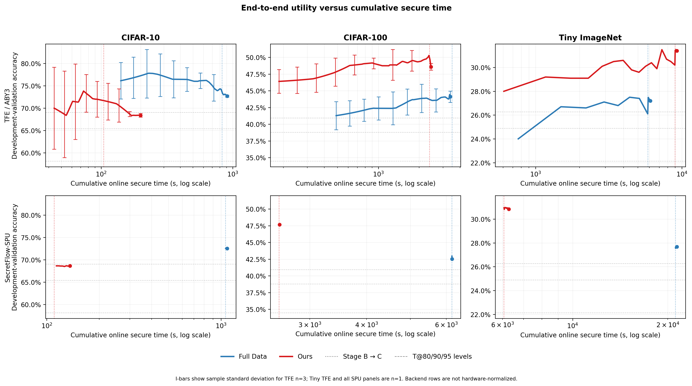
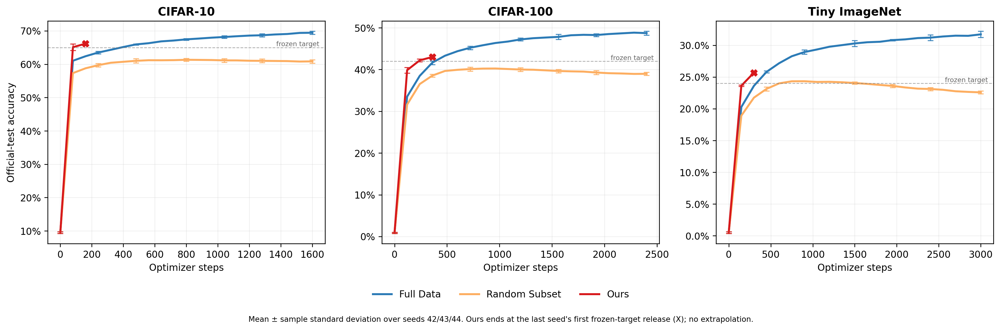
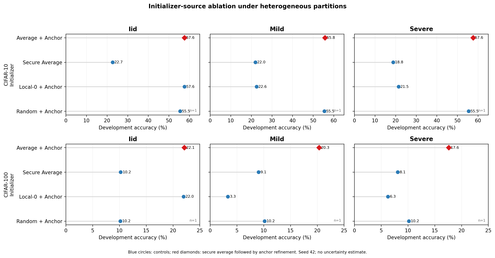
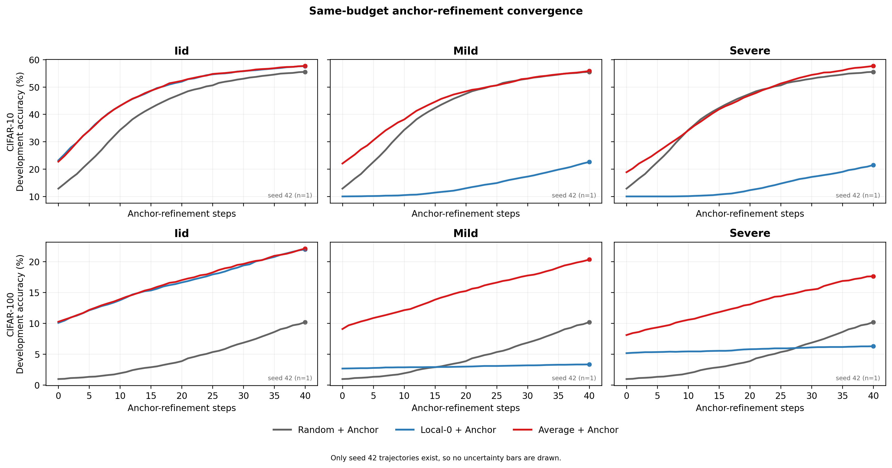

# Abstract

Secure multi-party computation (MPC)-based multi-party learning (MPL) allows multiple parties to jointly train a model while keeping local data hidden during computation. Nevertheless, the released model may still disclose information about individual records, motivating differential privacy (DP) during training. In practice, combining DP with secret-sharing-based learning can substantially increase training cost and reduce model quality, limiting deployment on larger tasks.

To address this limitation, we propose a cross-stage optimization framework for differentially private MPL. The framework jointly optimizes the protected workload, global initialization, and private updates. Trajectory-matching dataset distillation constructs compact local training carriers, while lightweight models trained on secret-shared features are securely averaged and refined using class-balanced labeled anchors. Adaptive clipping adjusts the clipping bound according to gradient-norm statistics. We implement the framework in two open-source MPL frameworks, namely TF Encrypted and SecretFlow. Development-validation experiments cover CIFAR-10, CIFAR-100, and Tiny ImageNet. Using only 9.6% of the CIFAR-100 training samples, the distilled carrier retains 89.8% of full-data accuracy. Under TFE/ABY3, the complete pipeline reduces time to target by 60.5%, corresponding to a 2.53× speedup, while improving final validation accuracy by 12.5% and reducing total secure time by 30.4%. [Secure runtime and communication results on SecretFlow will be added.] These results demonstrate that cross-stage optimization can jointly improve secure-training efficiency and model utility.

# 摘要（中文翻译）

基于安全多方计算（MPC）的多方学习（MPL）允许多个参与方在计算过程中隐藏本地数据的同时联合训练模型。然而，发布的模型仍可能泄露单条记录的信息，因此需要在训练中引入差分隐私（DP）。在实践中，将 DP 与基于秘密共享的学习结合会显著增加训练成本并降低模型质量，从而限制其在更大规模任务上的部署。

为解决这一局限，我们提出一种面向差分隐私 MPL 的跨阶段优化框架。该框架协同优化受保护训练负载、全局初始化和私有更新。轨迹匹配数据集蒸馏用于构建紧凑的本地训练载体；随后，在秘密共享特征上训练的轻量模型经过安全平均，并利用类别平衡的带标签锚点进行修正。自适应裁剪根据梯度范数统计调整裁剪阈值。我们在两个开源 MPL 框架，即 TF Encrypted 和 SecretFlow 中实现该框架。开发验证实验覆盖 CIFAR-10、CIFAR-100 和 Tiny ImageNet。仅使用 CIFAR-100 训练样本的 9.6%，蒸馏训练载体即可保留完整数据训练准确率的 89.8%。在 TFE/ABY3 下，完整流程将达到目标准确率所需的时间减少 60.5%，实现 2.53 倍加速，同时将最终验证准确率相对提高 12.5%，并将安全训练总时间减少 30.4%。[SecretFlow 上的安全运行时间和通信结果将在实验完成后补充。] 这些结果表明，跨阶段优化能够同时改善安全训练效率和模型效用。

# Introduction

Data-driven decisions in healthcare, finance, and online services depend on information held by multiple organizations. For example, several hospitals could jointly train a reliable diagnostic model from their combined patient populations. However, privacy regulations and institutional policies often prohibit direct pooling of patient records. To support such collaboration, secure multi-party computation (MPC)-based multi-party learning (MPL) enables training over distributed data while concealing private inputs and intermediate values. Systems such as SecureML [1] and SecureNN [2] have consequently been proposed, alongside open-source frameworks including TF Encrypted [3] and SecretFlow-SPU [4]. Yet model privacy is not guaranteed after release. With only model access, the participation of a particular record may still be inferred through membership inference attacks [5]. Differential privacy (DP) provides complementary output protection by limiting each record's influence on the released model [6]. This protection is implemented in DP-SGD through per-example gradient clipping and calibrated noise [7].

When DP is combined with secret-sharing-based MPL, training costs are substantially increased. Each sample and optimization step requires protected arithmetic and communication, while convergence may be slowed and utility reduced by privacy noise. Existing MPL optimizations typically address only individual costs. Cryptographic primitives have been improved by secure systems, whereas model complexity and training time are reduced in PEA through feature extraction and local-model-based initialization [8]. Although these advances establish the feasibility of differentially private MPL, protected data volume, initialization quality, and private-update effectiveness remain coupled. Training is prolonged by costly data representations. Additional private steps are consumed by unreliable initialization, and useful gradient information may be discarded when clipping is selected independently of the resulting trajectory.

This coupling suggests that differentially private MPL should be considered from a cross-stage perspective. A large training set can be replaced by a compact synthetic carrier that preserves task-relevant learning behavior through dataset distillation [9]. Before private training, locally learned parameters can be securely averaged and corrected with class-balanced labeled anchors to obtain a reliable global initializer. Changing gradient scales can then be tracked by adaptive clipping instead of being handled with one fixed threshold [12]. Perturbation within secure computation can also be supported by distributed noise generation [13]. Coordinating these stages can reduce protected data volume and secure iterations under a privacy budget and target accuracy while preserving private-update effectiveness.

Accordingly, a three-stage cross-stage optimization framework is proposed. First, compact training carriers are constructed through trajectory-matching dataset distillation so that fewer samples are processed securely. Second, lightweight local heads are trained over protected compact features. Their parameters are securely aggregated, and the resulting initializer is refined with class-balanced labeled anchors. Cross-party information is therefore coordinated before private global optimization. Third, the clipping bound is updated from gradient-norm statistics, after which calibrated perturbation is applied. An integrated workflow is formed. Protected training data and class structure are supplied by the compact carriers, while the optimization burden is reduced by the refined initializer. The resulting training trajectory is then accommodated through adaptive clipping.

The framework is developed for two open-source MPL platforms, TF Encrypted [3] and SecretFlow [4], and is evaluated on CIFAR-10, CIFAR-100, and Tiny ImageNet. In current TFE/ABY3 experiments, 89.8% of full-data accuracy is retained by a carrier containing 9.6% of the CIFAR-100 samples. Within the evaluated secure pipeline, time to target is reduced by 60.5%, corresponding to a 2.53x speedup. Final validation accuracy is improved by 12.5%, and total secure time is reduced by 30.4%. [TO VERIFY: replace the platform statement and insert matched SecretFlow runtime and communication results after the frozen SecretFlow experiments.] These results indicate that secure learning's efficiency-utility profile can be improved by coordinating data, initialization, and private optimization.

## Main Contributions

Our main contributions are summarized as follows:

1. We identify protected data workload, heterogeneous global initialization, and private-update utility as three coupled bottlenecks in differentially private MPL and coordinate their optimization within a unified framework.

2. We introduce trajectory-matched training carriers to reduce protected sample volume and connect their class structure to global initialization.

3. We design a secure-average initializer with class-balanced anchor refinement to coordinate heterogeneous cross-party information before private training.

4. We develop an adaptive private optimizer and an MPC-oriented workflow to evaluate utility, time to target, secure runtime, and numerical consistency across stages.

# 引言（中文翻译）

医疗、金融和在线服务中的数据驱动决策依赖由多个组织分别持有的信息。例如，多家医院可以利用各自的患者群体联合训练可靠的疾病诊断模型。然而，隐私法规和机构政策通常禁止直接汇集患者记录。为支持此类协作，基于安全多方计算（MPC）的多方学习（MPL）能够在隐藏私有输入和中间值的同时，利用分布式数据训练模型。由此，SecureML [1]、SecureNN [2] 等系统以及 TF Encrypted [3] 和 SecretFlow-SPU [4] 等开源框架相继被提出。然而，模型发布后的隐私并不能自动得到保证。即使只能访问模型，攻击者仍可能通过成员推断攻击判断某条记录是否参与了训练 [5]。差分隐私（DP）通过限制单条记录对发布模型的影响提供互补的输出保护 [6]。在 DP-SGD 中，这种保护通过单样本梯度裁剪和校准噪声实现 [7]。

当 DP 与基于秘密共享的 MPL 相结合时，训练成本会显著增加。每个样本和优化步骤都需要执行受保护的算术与通信操作，而隐私噪声还可能减缓收敛并降低模型效用。现有 MPL 优化通常只处理个别成本。安全学习系统对密码学原语进行了改进；在 PEA 中，模型复杂度和训练时间通过特征提取以及基于本地模型的初始化得到降低 [8]。尽管这些进展证明了差分隐私 MPL 的可行性，受保护数据规模、初始化质量和私有更新有效性仍然相互关联。高成本的数据表示会延长训练过程。不可靠的初始化会消耗更多私有更新步骤，而独立于实际训练轨迹选择的裁剪可能丢弃有用的梯度信息。

这种关联性表明，差分隐私 MPL 应当从跨阶段视角进行研究。通过数据集蒸馏，大规模训练集可以被保留任务相关学习行为的紧凑合成载体替代 [9]。在私有训练开始前，本地学习得到的参数可以经过安全平均，并利用类别平衡的带标签 Anchor 进行修正，从而获得可靠的全局初始化模型。随后，变化的梯度尺度可以由自适应裁剪进行跟踪，而不必始终采用一个固定阈值 [12]。安全计算内部的扰动也可以通过分布式噪声生成得到支持 [13]。通过协调这些阶段，可以在给定隐私预算和目标准确率的条件下减少受保护数据规模与安全迭代次数，同时保持私有更新的有效性。

据此，一种三阶段跨阶段优化框架被提出。首先，通过轨迹匹配数据集蒸馏构建紧凑训练载体，从而减少需要安全处理的样本数量。其次，在受保护的紧凑特征上训练轻量本地分类头，对其参数进行安全聚合，并利用类别平衡的带标签锚点修正所得初始化模型。由此，跨方信息在私有全局优化开始前得到协调。最后，根据梯度范数统计更新裁剪阈值，并在此后施加校准扰动。上述阶段共同构成一个完整流程。受保护训练数据和类别结构由紧凑载体提供，优化负担通过修正后的初始化模型得到降低，而自适应裁剪则用于适应前序阶段产生的训练轨迹。

该框架面向两个开源 MPL 平台 TF Encrypted [3] 和 SecretFlow [4] 进行开发，并在 CIFAR-10、CIFAR-100 和 Tiny ImageNet 上接受评估。在当前 TFE/ABY3 实验中，仅包含 CIFAR-100 训练样本 9.6% 的紧凑载体保留了完整数据准确率的 89.8%。在经过评估的安全训练流程中，达到目标准确率所需的时间减少了 60.5%，对应 2.53 倍加速。最终验证准确率相对提高了 12.5%，安全训练总时间减少了 30.4%。[待验证：完成冻结的 SecretFlow 实验后，替换平台实现表述并补充匹配的 SecretFlow 运行时间和通信结果。] 这些结果表明，通过协调数据、初始化和私有优化，可以改善安全学习的效率与效用关系。

## 主要贡献

本文的主要贡献概括如下：

1. 我们识别出差分隐私 MPL 中受保护数据负载、异构全局初始化和私有更新效用三个相互关联的瓶颈，并在统一框架中对其进行协同优化。

2. 我们引入轨迹匹配紧凑训练载体，以减少进入受保护计算的样本规模，并将其类别结构与全局初始化相连接。

3. 我们设计了结合类别平衡锚点修正的安全平均初始化方法，在私有训练前协调异构的跨方信息。

4. 我们开发了自适应私有优化器和面向 MPC 的执行流程，用于评估跨阶段模型效用、达标时间、安全运行时间和数值一致性。

# Related Work

## 2.1 MPC-Based Multi-Party Learning

Secure multi-party computation (MPC) allows a function to be evaluated over private inputs without revealing them beyond the prescribed output [14], [15]. This principle has been extended to multi-party learning (MPL), in which training operations are performed on secret-shared data and parameters. SecureML introduced efficient two-server protocols for linear models and neural networks [1], while SecureNN and ABY3 developed three-party protocols and mixed-protocol primitives for protected neural-network computation [2], [38]. Higher-level systems have subsequently improved programmability and execution efficiency. TF Encrypted provides TensorFlow-oriented secure-computation abstractions [3], whereas SecretFlow-SPU compiles numerical programs for several MPC backends [4]. Despite these advances, protected nonlinear operations, fixed-point arithmetic, and repeated communication remain substantially more expensive than plaintext training.

MPL is related to, but distinct from, federated learning (FL). In FL, local optimization is usually performed in plaintext and model updates are periodically aggregated, as in FedAvg [17], [18]. Secure aggregation conceals individual updates but generally reveals their aggregate [16]. In MPC-based MPL, a broader portion of training, including global optimization and intermediate computation, can be executed on secret shares. The local preprocessing and initialization stages considered here resemble an FL workflow, but the subsequent protected global training follows the MPL model. This distinction determines both the privacy boundary and the dominant system cost.

## 2.2 Differential Privacy in Secure Learning

Differential privacy (DP) limits the influence of an individual record on a randomized output [6]. DP-SGD applies this protection during training by clipping per-example gradients and adding calibrated Gaussian noise before each model update [7], [21]. Because repeated accesses consume privacy budget, composition is tracked through mechanisms such as Renyi differential privacy and subsampled privacy accounting [19], [20]. Model utility depends strongly on the clipping bound. An overly small bound introduces clipping bias, whereas an overly large bound increases sensitivity and noise magnitude [24].

Several strategies have been developed to avoid a single manually tuned threshold. AdaCliP adapts clipping across gradient coordinates [22], quantile-based adaptive clipping tracks the evolving distribution of update norms [12], and automatic clipping normalizes updates to reduce explicit threshold tuning [23]. These methods have mainly been studied in plaintext or federated training. In MPC-based learning, gradient-norm estimation, threshold updates, clipping, and perturbation must additionally be represented by secure operations. Their interaction with secure runtime and numerical approximation therefore becomes a system-level concern.

Distributed private learning further combines secure aggregation with calibrated randomization [16]. Representative mechanisms include the distributed discrete Gaussian mechanism [36], the Poisson binomial mechanism [37], and secure protocols for efficient DP noise generation [13]. Output privacy can also be obtained through noisy aggregation of independently trained predictors, as demonstrated by PATE [31]. At the system level, PEA integrates secure DP-SGD with model simplification and initialization in secret-sharing-based MPL [8]. These studies establish the feasibility of combining secure computation and DP, but data reduction, global initialization, and private optimization are generally treated as separate concerns.

## 2.3 Dataset Distillation

Training-set reduction can be achieved either by selecting existing records or by synthesizing new ones. Coreset methods retain representative samples from the original dataset [25], whereas dataset distillation optimizes a compact synthetic set whose training behavior approximates that of the full dataset [26]. Existing approaches match gradients [27], solve surrogate kernel objectives [28], or improve synthetic-data optimization through differentiable augmentation [29]. Matching Training Trajectories (MTT) instead aligns multi-step parameter trajectories generated from real and synthetic data [9]. DC-BENCH further shows that distillation quality depends on the compression ratio, evaluation architecture, and augmentation protocol [30].

Most dataset-distillation studies are evaluated through plaintext model utility. In protected learning, a compact training carrier may also reduce the number of samples entering expensive secure operations. This benefit differs from feature compression, which reduces the representation of every sample but retains the original sample count. However, synthetic data are not automatically private, and their secure-system benefit cannot be inferred from plaintext accuracy alone. The construction boundary, source-data protection, architecture transfer, and reduction in protected computation must therefore be considered separately when distillation is incorporated into MPL.

## 2.4 Secure Global Initialization and Anchor-Based Refinement

The initial global model can substantially affect the convergence of collaborative training. FedAvg constructs a shared model by averaging parameters obtained through local optimization [17], [18], while secure aggregation prevents an aggregator from observing individual updates [16]. However, when local data are non-IID, independently trained models may emphasize different classes or optimization directions. Direct parameter averaging can therefore provide an unstable starting point for subsequent global training, even when the aggregation itself is securely executed.

Prediction-level collaboration offers an alternative to parameter averaging. Knowledge distillation transfers softened outputs from a teacher to a student [10], and methods such as FedMD, FedDF, Federated Distillation, FedKD, and group knowledge transfer use predictions or distilled representations to coordinate heterogeneous participants [11], [32], [33], [34], [35]. These methods are relevant alternatives for handling heterogeneity, but they are not components of the present framework.

The initialization stage studied here assumes a shared lightweight model architecture. Local model parameters are first averaged under secret sharing. The aggregated model is then refined on a disjoint, class-balanced set of labeled anchors using supervised cross-entropy. Because hard labels are optimized directly without teacher probabilities, temperature scaling, or a distillation loss, this operation is post-aggregation supervised refinement rather than KD. The resulting initializer connects the compact training carrier to the subsequent private optimization stage.

# 相关工作（中文翻译）

## 2.1 基于 MPC 的多方学习

安全多方计算（MPC）允许多个参与方在不泄露私有输入的情况下对其执行函数计算，除规定输出外不暴露额外信息 [14], [15]。这一思想已被扩展至多方学习（MPL），使训练操作能够在秘密共享的数据和参数上执行。SecureML 为线性模型和神经网络引入了高效的双服务器协议 [1]，SecureNN 和 ABY3 则分别提出了面向受保护神经网络计算的三方协议与混合协议原语 [2], [38]。随后，更高层的系统进一步改善了可编程性和执行效率。TF Encrypted 提供面向 TensorFlow 的安全计算抽象 [3]，SecretFlow-SPU 则能够面向多种 MPC 后端编译数值程序 [4]。尽管取得了这些进展，受保护的非线性运算、定点计算和重复通信仍然比明文训练昂贵得多。

MPL 与联邦学习（FL）相关，但二者并不相同。在 FL 中，本地优化通常以明文形式执行，模型更新则按照 FedAvg 等方法进行周期性聚合 [17], [18]。安全聚合能够隐藏单个参与方的更新，但通常仍会公开聚合结果 [16]。在基于 MPC 的 MPL 中，包括全局优化和中间计算在内的更多训练操作可以在秘密份额上执行。本文的本地预处理和初始化阶段在流程形式上与 FL 相似，但后续受保护的全局训练遵循 MPL 模型。这一区别决定了系统的隐私边界和主要成本来源。

## 2.2 安全学习中的差分隐私

差分隐私（DP）限制单条记录对随机化输出的影响 [6]。DP-SGD 通过裁剪单样本梯度，并在每次模型更新前加入经过校准的高斯噪声，在训练过程中实现这种保护 [7], [21]。由于重复访问数据会消耗隐私预算，因此需要利用 Rényi 差分隐私和子采样隐私会计等机制进行组合计算 [19], [20]。模型效用在很大程度上取决于裁剪阈值。过小的阈值会引入裁剪偏差，过大的阈值则会提高敏感度和噪声幅度 [24]。

为避免始终采用人工调节的单一阈值，多种自适应策略已被提出。AdaCliP 在不同梯度坐标上自适应调整裁剪 [22]，基于分位数的自适应裁剪跟踪不断变化的更新范数分布 [12]，Automatic Clipping 则通过归一化更新减少对显式阈值调节的依赖 [23]。这些方法主要在明文或联邦训练中得到研究。在基于 MPC 的学习中，梯度范数估计、阈值更新、裁剪和扰动还必须表示为安全运算。因此，它们与安全运行时间和数值近似之间的相互影响会进一步成为系统层面的问题。

分布式私有学习还将安全聚合与经过校准的随机化机制相结合 [16]。代表性方法包括分布式离散高斯机制 [36]、Poisson Binomial 机制 [37]，以及面向高效 DP 噪声生成的安全协议 [13]。PATE 则通过对独立训练的预测器进行带噪聚合实现输出隐私 [31]。在系统层面，PEA 将安全 DP-SGD 与模型简化和初始化引入基于秘密共享的 MPL [8]。这些研究证明了安全计算与 DP 结合的可行性，但数据缩减、全局初始化和私有优化通常仍被作为彼此独立的问题处理。

## 2.3 数据集蒸馏

训练集缩减既可以通过选择已有记录实现，也可以通过合成新样本实现。Coreset 方法从原始数据集中保留具有代表性的样本 [25]，而数据集蒸馏则优化一个紧凑合成集，使其训练行为近似完整数据集 [26]。现有方法包括梯度匹配 [27]、求解替代核目标 [28]，以及利用可微数据增强改善合成数据优化 [29]。训练轨迹匹配（MTT）进一步对齐由真实数据和合成数据产生的多步参数轨迹 [9]。DC-BENCH 的研究还表明，蒸馏质量会受到压缩率、评估架构和数据增强协议的影响 [30]。

现有数据集蒸馏研究大多通过明文环境下的模型效用进行评估。在受保护学习中，紧凑训练载体还可以减少进入高成本安全运算的样本数量。这一收益不同于特征压缩，后者虽然缩减了每个样本的表示，却仍然保留原始样本数量。然而，合成数据并不会自动获得隐私保护，其安全系统收益也无法仅根据明文准确率推断。当数据集蒸馏被引入 MPL 时，数据构建边界、源数据保护、架构迁移能力和受保护计算量的降低需要分别进行分析。

## 2.4 安全全局初始化与基于 Anchor 的修正

全局初始模型会显著影响协同训练的收敛过程。FedAvg 对本地优化得到的模型参数进行平均以构造共享模型 [17], [18]，安全聚合则防止聚合方观察单个参与方的更新 [16]。然而，当本地数据呈 non-IID 分布时，独立训练的模型可能偏向不同类别或优化方向。因此，即使聚合过程在安全环境中执行，直接参数平均仍可能为后续全局训练提供不稳定的起点。

基于预测的协作是参数平均的一类替代路线。知识蒸馏将教师模型的软化输出迁移至学生模型 [10]；FedMD、FedDF、Federated Distillation、FedKD 和 Group Knowledge Transfer 等方法则通过预测结果或蒸馏表示协调异构参与方 [11], [32], [33], [34], [35]。这些方法是处理异构性的重要相关路线，但并不是本文框架的组成部分。

本文研究的初始化阶段假设各方采用相同的轻量模型架构。本地模型参数首先在秘密共享环境下进行平均，随后使用一个相互独立且类别平衡的带标签 Anchor 集，通过监督交叉熵对聚合模型进行修正。由于该过程直接优化硬标签，不使用教师概率、温度缩放或蒸馏损失，因此它属于聚合后的监督修正，而不是 KD。所得初始化模型将紧凑训练载体与后续私有优化阶段连接起来。

# 3. Overview

## 3.1 System Participants and Workflow

The system consists of $m$ data owners $P_1,\ldots,P_m$, a set of MPC computing parties $C_1,\ldots,C_q$, and a model user $U$. Data owner $P_i$ holds a private local dataset $D_i=\{(x_{i,n},y_{i,n})\}_{n=1}^{N_i}$ and independently constructs a compact distilled carrier $D_i^{\mathrm{syn}}$ inside its trusted local environment. A common frozen encoder $\phi$ maps each distilled sample to a fixed-dimensional feature, producing the compact labeled representation set $\mathcal{Z}_i=\{(z_{i,j},y_{i,j})\}$, where $z_{i,j}=\phi(x_{i,j}^{\mathrm{syn}})$. For subsequent initialization, $\mathcal{Z}_i$ provides a local-head training portion and a disjoint labeled-anchor contribution. The model user is authorized to receive the final reconstructed model $\theta^*$ but does not obtain any local dataset, compact representation, or intermediate training value.

The execution boundary separates local plaintext preparation from global learning over secret-shared values. Stage A is performed locally because trajectory matching requires repeated access to each owner's source data and expert trajectories [9]. The common encoder is then held fixed while the distilled samples are encoded. Before global processing, the compact features and their labels are independently converted into secret shares, denoted by $\langle\mathcal{Z}_i\rangle$. The computing parties operate on these shares through TF Encrypted or SecretFlow-SPU [3], [4]. When three-party ABY3 is selected as the underlying protocol, each protected value is distributed across three computing parties [38]. The resulting model parameters, gradients, clipping statistics, and intermediate updates remain secret-shared until an authorized output is reconstructed.

The global workflow contains three connected stages. Stage A transforms each $D_i$ into $D_i^{\mathrm{syn}}$ through trajectory-matching dataset distillation and then produces $\mathcal{Z}_i$ with the common frozen encoder. In Stage B, a lightweight local head $\langle\theta_i\rangle$ is trained for each data owner over its secret-shared compact training portion. The local-head parameters are securely averaged to obtain $\langle\bar{\theta}\rangle$, after which supervised cross-entropy updates over the secret-shared labeled anchors produce the refined initializer $\langle\theta_B\rangle$. No teacher probabilities, distillation loss, or initialization candidate selection is used. In Stage C, secure adaptive private optimization jointly receives $\langle\theta_B\rangle$ and the logically combined compact labeled representations. It repeatedly computes per-example gradients, updates the clipping bound $C_t$ from protected gradient-norm statistics, clips and aggregates the gradients, adds calibrated noise, and securely updates the model [7], [12], [13]. After the final iteration, the model remains represented as shares $\langle\theta_T\rangle$ until authorized reconstruction yields $\theta^*$.

The stages are connected by both data and model flow. Stage A reduces the number of protected records and supplies the compact labeled representations used by Stages B and C. Stage B converts the securely trained local heads into a refined global initializer intended to reduce the optimization burden of Stage C. Stage C starts from this initializer and adapts its clipping bound to the resulting gradient trajectory. The framework therefore coordinates protected data volume, global initialization, and private updates rather than treating them as independent optimizations.

**Figure 1. System model and cross-stage workflow.** Green blocks denote local plaintext compact-data construction, including dataset distillation and encoding with the common frozen encoder. Blue elements denote secret sharing and secure global initialization, while purple elements denote iterative adaptive private optimization. Compact labeled representations are secret-shared before entering the MPC domain. Stage B produces $\langle\theta_B\rangle$ through secure local-head training, parameter averaging, and labeled-anchor refinement. Stage C combines this initializer with the compact representations and returns final model shares $\langle\theta_T\rangle$, which may be reconstructed only at the authorized output boundary.

## 3.2 Threat Model and Privacy Goals

A semi-honest threat model is considered. Data owners and computing parties follow the specified protocol but may inspect their local views and received messages in an attempt to infer private information. The tolerated collusion threshold is determined by the selected MPC backend. Under the three-party ABY3 setting, an honest majority is assumed and at most one computing party may be corrupted [38]. Active protocol deviations, poisoning, denial-of-service attacks, side-channel leakage, and collusion beyond the backend threshold are outside the present scope. The model user may inspect the released model and attempt a membership-inference attack [5].

Two privacy goals are distinguished. First, computation privacy is provided by MPC. Source-derived compact records, labeled anchors, local and global model parameters, per-example gradients, clipping statistics, noise values, and intermediate updates are not revealed to an individual computing party. Only values explicitly designated by the protocol may be reconstructed. Second, model-output privacy is provided by DP. Under a declared adjacency relation, the Stage C mechanism limits the influence of one protected training record on the distribution of the released model through gradient clipping, calibrated perturbation, and privacy accounting [6], [7]. MPC and DP are complementary: MPC protects the execution process, whereas DP constrains information exposed through the authorized model output.

The privacy accounting boundary follows the data-dependent workflow. Local dataset distillation and labeled-anchor refinement do not automatically provide record-level DP. The declared $(\epsilon,\delta)$ budget therefore applies to the records and updates covered by the Stage C private optimizer. Establishing an end-to-end source-record guarantee additionally requires a private distillation mechanism, a stability relation between source datasets and distilled carriers, or explicit composition across every data-dependent stage that influences $\theta^*$. This boundary separates the guarantees supplied by the current MPC execution from those supplied by the private optimizer.

# 第三章 概述（中文翻译）

## 3.1 系统参与方与工作流程

系统由 $m$ 个数据持有方 $P_1,\ldots,P_m$、一组 MPC 计算方 $C_1,\ldots,C_q$ 以及模型使用者 $U$ 组成。数据持有方 $P_i$ 拥有私有本地数据集 $D_i=\{(x_{i,n},y_{i,n})\}_{n=1}^{N_i}$，并在可信本地环境中独立构建紧凑蒸馏载体 $D_i^{\mathrm{syn}}$。公共冻结编码器 $\phi$ 将每个蒸馏样本映射为固定维度特征，形成紧凑带标签表示集 $\mathcal{Z}_i=\{(z_{i,j},y_{i,j})\}$，其中 $z_{i,j}=\phi(x_{i,j}^{\mathrm{syn}})$。为支持后续初始化，$\mathcal{Z}_i$ 提供本地分类头训练部分和与其互不重叠的带标签 Anchor 贡献。模型使用者仅被授权获得最终重构模型 $\theta^*$，不能获得任何本地数据集、紧凑表示或中间训练值。

执行边界将本地明文准备与基于秘密共享值的全局学习分离。Stage A 由各数据持有方在本地执行，因为轨迹匹配需要重复访问各方源数据和专家训练轨迹 [9]。随后，公共编码器保持冻结并用于编码蒸馏样本。在进入全局处理前，紧凑特征及其标签被各方独立转换为秘密份额，记为 $\langle\mathcal{Z}_i\rangle$。计算方通过 TF Encrypted 或 SecretFlow-SPU 在这些份额上执行运算 [3], [4]。当底层采用三方 ABY3 协议时，每个受保护值被分布在三个计算方之间 [38]。由此产生的模型参数、梯度、裁剪统计量和中间更新在授权输出被重构前始终保持秘密共享状态。

全局工作流程包含三个相互连接的阶段。Stage A 通过轨迹匹配数据集蒸馏将每个 $D_i$ 转换为 $D_i^{\mathrm{syn}}$，随后利用公共冻结编码器生成 $\mathcal{Z}_i$。在 Stage B 中，针对每个数据持有方，在其秘密共享的紧凑训练部分上训练轻量本地分类头 $\langle\theta_i\rangle$。本地分类头参数经过安全平均得到 $\langle\bar{\theta}\rangle$，随后在秘密共享的带标签 Anchor 上执行监督交叉熵更新，产生修正后的初始化模型 $\langle\theta_B\rangle$。该阶段不使用教师概率、蒸馏损失或初始化候选选择。在 Stage C 中，安全自适应私有优化同时接收 $\langle\theta_B\rangle$ 和逻辑合并的紧凑带标签表示。该阶段迭代计算单样本梯度，根据受保护的梯度范数统计更新裁剪阈值 $C_t$，对梯度进行裁剪与聚合，加入校准噪声，并安全更新模型 [7], [12], [13]。最后一轮结束后，模型以秘密份额 $\langle\theta_T\rangle$ 的形式保留，直至授权重构得到 $\theta^*$。

三个阶段通过数据流和模型流相互连接。Stage A 减少受保护记录数量，并为 Stage B 和 Stage C 提供紧凑带标签表示。Stage B 将安全训练的本地分类头转换为修正后的全局初始化模型，以降低 Stage C 的后续优化负担。Stage C 从该初始化模型出发，并根据形成的梯度轨迹调整裁剪阈值。因此，该框架协同处理受保护数据规模、全局初始化和私有更新，而不是将三者视为彼此独立的优化问题。

**图 1. 系统模型与跨阶段工作流程。** 绿色模块表示本地明文紧凑数据构建，包括数据集蒸馏和使用公共冻结编码器进行编码。蓝色元素表示秘密共享与安全全局初始化，紫色元素表示迭代式自适应私有优化。紧凑带标签表示在进入 MPC 域前被转换为秘密份额。Stage B 通过安全本地分类头训练、参数平均和带标签 Anchor 修正产生 $\langle\theta_B\rangle$。Stage C 将该初始化模型与紧凑表示结合，并输出最终模型份额 $\langle\theta_T\rangle$；该模型只能在授权输出边界处被重构。

## 3.2 威胁模型与隐私目标

本文采用半诚实威胁模型。数据持有方和计算方遵循规定协议，但可能检查其本地视图和接收到的消息，以尝试推断私有信息。系统允许的串谋阈值由所选 MPC 后端决定。在三方 ABY3 设置下，系统假设诚实多数，并允许至多一个计算方被腐化 [38]。主动协议偏离、投毒、拒绝服务攻击、侧信道泄露以及超过底层协议阈值的串谋不在本文讨论范围内。模型使用者可能检查发布模型并发起成员推断攻击 [5]。

框架区分两类隐私目标。第一，计算过程隐私由 MPC 提供。由源数据产生的紧凑记录、带标签 Anchor、本地与全局模型参数、单样本梯度、裁剪统计量、噪声值和中间更新均不会向任何单个计算方公开。只有协议明确指定的值才可以被重构。第二，模型输出隐私由 DP 提供。在声明的相邻关系下，Stage C 机制通过梯度裁剪、校准扰动和隐私会计，限制单条受保护训练记录对发布模型分布的影响 [6], [7]。MPC 与 DP 相互补充：MPC 保护执行过程，DP 则约束授权模型输出所暴露的信息。

隐私会计边界遵循上述数据依赖流程。本地数据集蒸馏和带标签 Anchor 修正本身不会自动提供记录级 DP。因此，声明的 $(\epsilon,\delta)$ 预算适用于 Stage C 私有优化器覆盖的记录与更新。若要建立面向源数据记录的端到端保证，还需要采用私有数据集蒸馏机制、建立源数据集与蒸馏载体之间的稳定性关系，或者对所有影响 $\theta^*$ 的数据依赖阶段进行显式组合会计。该边界明确区分了当前 MPC 执行所提供的保证与私有优化器所提供的保证。

# 4. Methodology

## 4.1 Compact Labeled Representation Construction

For data owner $P_i$, Stage A replaces the full local dataset $D_i$ with a much smaller labeled synthetic set $D_i^{\mathrm{syn}}=\{(x_{i,j}^{\mathrm{syn}},y_{i,j}^{\mathrm{syn}})\}_{j=1}^{S_i}$, where $S_i\ll N_i$. The set is constructed locally by matching the optimization trajectory induced by the synthetic samples to an expert trajectory obtained from $D_i$ [9]. Let $w_{i,t}^{E}$ and $w_{i,t+K}^{E}$ denote two checkpoints on an expert trajectory. Starting from $w_{i,t}^{E}$, $J$ updates on $D_i^{\mathrm{syn}}$ produce $\hat{w}_{i,t+J}$. The distilled samples are optimized by minimizing

$$
\mathcal{L}_{\mathrm{MTT}}(D_i^{\mathrm{syn}})=
\mathbb{E}_{t}
\left[
\frac{\|\hat{w}_{i,t+J}-w_{i,t+K}^{E}\|_2^2}
{\|w_{i,t}^{E}-w_{i,t+K}^{E}\|_2^2+\xi}
\right],
$$

where $\xi>0$ prevents numerical instability. This objective preserves training behavior rather than selecting existing records, allowing the number of samples entering protected computation to be reduced directly.

A common encoder $\phi$ is fixed before global protected training and used by every owner. Each synthetic image is mapped to $\tilde{z}_{i,j}=\phi(x_{i,j}^{\mathrm{syn}})$. Using normalization parameters associated with the shared encoder, the resulting feature is standardized and norm-bounded as

$$
z_{i,j}=\bar{z}_{i,j}\min\left(1,\frac{R}{\|\bar{z}_{i,j}\|_2+\tau}\right),
$$

where $R$ is the public feature-norm bound and $\tau$ is a small constant. The output is a compact labeled representation set $\mathcal{Z}_i=\{(z_{i,j},y_{i,j}^{\mathrm{syn}})\}$. A class-balanced partition produces a local training subset $\mathcal{Z}_i^{\mathrm{tr}}$ and a disjoint labeled-anchor subset $\mathcal{Z}_i^{\mathrm{anc}}$. Features and labels from both subsets are secret-shared before leaving $P_i$; raw samples and distilled images remain in the local domain.

## 4.2 Secure Global Initialization

Stage B learns only a lightweight classification head on top of the frozen representation. Let $h_{\theta}(z)=zW+b$, where $\theta=(W,b)$. All local heads start from the same public initialization $\theta_0$. For each owner, the computing parties minimize the secret-shared local objective

$$
\mathcal{L}_i(\theta)=\frac{1}{|\mathcal{Z}_i^{\mathrm{tr}}|}
\sum_{(z,y)\in\mathcal{Z}_i^{\mathrm{tr}}}
\operatorname{CE}(\operatorname{softmax}(h_{\theta}(z)),y)
+\frac{\lambda_w}{2}\|W\|_2^2,
$$

and obtain $\langle\theta_i\rangle$ without reconstructing the local features, labels, gradients, or parameters. The local heads share the same architecture and are combined by secure parameter averaging,

$$
\langle\bar{\theta}\rangle=\frac{1}{m}\sum_{i=1}^{m}\langle\theta_i\rangle.
$$

Parameter averaging transfers information from all owners, but its prediction boundary may remain biased when the local distributions differ. The union of the disjoint anchor contributions, $\mathcal{Z}^{\mathrm{anc}}=\bigcup_i\mathcal{Z}_i^{\mathrm{anc}}$, is therefore used to refine the averaged head with hard-label supervision. Starting from $\theta_B^{(0)}=\bar{\theta}$, the protected refinement minimizes

$$
\mathcal{L}_{\mathrm{anc}}(\theta)=
\frac{1}{|\mathcal{Z}^{\mathrm{anc}}|}
\sum_{(z,y)\in\mathcal{Z}^{\mathrm{anc}}}
\operatorname{CE}(\operatorname{softmax}(h_{\theta}(z)),y)
+\mu\|\theta-\bar{\theta}\|_2^2.
$$

The optional proximal term controls excessive deviation from the cross-party average. This is supervised post-aggregation refinement: no teacher logits, temperature parameter, or distillation loss is introduced.

> **Protocol 1: Secure Global Initialization**  
> **Input:** $\{\langle\mathcal{Z}_i^{\mathrm{tr}}\rangle,\langle\mathcal{Z}_i^{\mathrm{anc}}\rangle\}_{i=1}^{m}$, public $\theta_0$, local learning rate $\eta_L$, local rounds $E_L$, refinement rate $\eta_B$, refinement steps $R_B$, and $\mu$.  
> **Output:** Refined initializer $\langle\theta_B\rangle$.  
> 1. For every $P_i$, initialize $\langle\theta_i\rangle\leftarrow\theta_0$ and perform $E_L$ secure gradient updates on $\langle\mathcal{Z}_i^{\mathrm{tr}}\rangle$.  
> 2. Compute $\langle\bar{\theta}\rangle\leftarrow m^{-1}\sum_i\langle\theta_i\rangle$.  
> 3. Set $\langle\theta_B^{(0)}\rangle\leftarrow\langle\bar{\theta}\rangle$ and logically concatenate the secret-shared anchor subsets.  
> 4. For $r=0,\ldots,R_B-1$, compute $\langle g_r\rangle=\nabla_{\theta}\mathcal{L}_{\mathrm{anc}}(\langle\theta_B^{(r)}\rangle)$ and update $\langle\theta_B^{(r+1)}\rangle\leftarrow\langle\theta_B^{(r)}\rangle-\eta_B\langle g_r\rangle$.  
> 5. Return $\langle\theta_B\rangle=\langle\theta_B^{(R_B)}\rangle$ without reconstruction.

## 4.3 Secure Adaptive Private Optimization

Stage C starts from $\langle\theta_B\rangle$ and optimizes over $\mathcal{Z}^{\mathrm{opt}}=\bigcup_i\mathcal{Z}_i^{\mathrm{tr}}$. At iteration $t$, a minibatch $\mathcal{B}_t$ is sampled and a per-example gradient is computed for each $(z_j,y_j)\in\mathcal{B}_t$,

$$
\langle g_{t,j}\rangle=\nabla_{\theta}\ell(\langle\theta_t\rangle;\langle z_j,y_j\rangle).
$$

Instead of using one fixed clipping threshold throughout training, the mechanism tracks a target quantile of the protected gradient-norm distribution [12]. Let $b_{t,j}=\mathbb{I}[\|g_{t,j}\|_2\le C_t]$. A noised fraction is computed as

$$
\tilde{q}_t=\operatorname{clip}_{[0,1]}
\left(\frac{1}{|\mathcal{B}_t|}\sum_j b_{t,j}+\nu_t\right),
\qquad
\nu_t\sim\mathcal{N}\left(0,\frac{\sigma_c^2}{|\mathcal{B}_t|^2}\right).
$$

After an optional warm-up period and at a prescribed update interval, the clipping bound is adjusted by

$$
C_{t+1}=\operatorname{clip}_{[C_{\min},C_{\max}]}
\left(C_t\exp\big(\eta_C(\gamma-\tilde{q}_t)\big)\right),
$$

where $\gamma$ is the target fraction. Thus, the bound increases when too few gradients fall below $C_t$ and decreases when the observed fraction is larger than required. Between adaptation points, $C_{t+1}=C_t$.

Each gradient is clipped under secret sharing,

$$
\bar{g}_{t,j}=g_{t,j}\min\left(1,\frac{C_t}{\|g_{t,j}\|_2+\tau}\right),
$$

and the private update is

$$
\tilde{g}_t=\frac{1}{|\mathcal{B}_t|}\left(
\sum_j\bar{g}_{t,j}+\mathcal{N}(0,\sigma_g^2C_t^2I)
\right),
\qquad
\theta_{t+1}=\theta_t-\eta_t\tilde{g}_t.
$$

The Gaussian noise is generated from independent computing-party contributions so that no single party controls the final perturbation [13]. The privacy accountant composes the sampled Gaussian gradient mechanism with the noised clipping-count queries using Rényi DP [19], [20]. Consequently, the reported $(\epsilon,\delta)$ corresponds to the Stage C private mechanism under the boundary specified in Section 3.2.

> **Protocol 2: Secure Adaptive Private Optimization**  
> **Input:** $\langle\theta_B\rangle$, $\langle\mathcal{Z}^{\mathrm{opt}}\rangle$, steps $T$, sampling rate $q$, learning rates $\{\eta_t\}$, $C_0$, $C_{\min}$, $C_{\max}$, $\gamma$, $\eta_C$, $\sigma_g$, and $\sigma_c$.  
> **Output:** Final model shares $\langle\theta_T\rangle$ and the composed Stage C privacy cost.  
> 1. Set $\langle\theta_0\rangle\leftarrow\langle\theta_B\rangle$ and $\langle C_0\rangle\leftarrow C_0$.  
> 2. For $t=0,\ldots,T-1$, sample $\mathcal{B}_t$ and securely compute all $\langle g_{t,j}\rangle$ and their squared norms.  
> 3. At an adaptation point, securely evaluate the noised fraction $\langle\tilde q_t\rangle$ and update $\langle C_{t+1}\rangle$; otherwise retain $\langle C_t\rangle$.  
> 4. Securely clip the per-example gradients with $C_t$ and aggregate them.  
> 5. Generate distributed Gaussian noise, add it to the aggregate, and update $\langle\theta_{t+1}\rangle$.  
> 6. Compose the gradient and clipping-count mechanisms in the privacy accountant.  
> 7. Return $\langle\theta_T\rangle$; reconstruct only at the authorized output boundary.

## 4.4 Security and Cost Analysis

**Computation privacy.** Protocols 1 and 2 are expressed entirely through the arithmetic, comparison, and random-generation functionalities supplied by the underlying MPC backend. Their inputs are secret shares, and local features, labels, model parameters, gradients, norm indicators, clipping bounds, and noise contributions are not reconstructed during execution. Under the semi-honest model and the corruption threshold of the selected backend, the view of an admissible coalition can therefore be simulated from its own inputs and the prescribed output [14], [15]. By the sequential composition of secure subprotocols, the two protocols reveal no additional information beyond the final authorized model and any explicitly released DP statistics. In the three-party ABY3 instantiation, this statement holds against at most one corrupted computing party [38]. Fixed-point approximation may affect numerical accuracy, but it does not alter the computation-privacy argument as long as every approximation is evaluated inside the same secure execution.

**Stage C output privacy.** Consider neighboring compact training sets that differ in one record of $\mathcal{Z}^{\mathrm{opt}}$, and condition on the initializer $\theta_B$. Per-example clipping bounds the contribution of that record to the averaged gradient, while Gaussian perturbation protects each private update [7]. The statistic used to adapt $C_t$ is also perturbed before it affects subsequent thresholds. Let $\varepsilon_g^{(\alpha)}$ denote the order-$\alpha$ RDP cost of one subsampled gradient mechanism and $\varepsilon_c^{(\alpha)}$ the cost of one noised clipping-count query. If $T_C$ threshold adaptations are performed during $T$ training steps, the Stage C accountant obtains

$$
\epsilon_C(\delta)=\min_{\alpha>1}\left[
T\varepsilon_g^{(\alpha)}+T_C\varepsilon_c^{(\alpha)}
+\frac{\log(1/\delta)}{\alpha-1}
\right].
$$

This follows from RDP composition and conversion to $(\epsilon,\delta)$-DP [19], [20]. All later computations, including adaptive threshold updates and model reconstruction, are post-processing of the protected mechanisms. Hence, Protocol 2 is $(\epsilon_C,\delta)$-DP for the Stage C adjacency relation. If $\theta_B$ is data-independent, computed from disjoint public records, or produced by a separately DP mechanism, the guarantee composes with its corresponding privacy status. If it is obtained from non-private data-dependent preparation, $\epsilon_C$ is interpreted as the conditional Stage C guarantee rather than an end-to-end guarantee for the original source records, consistently with Section 3.2.

**Protected computation cost.** Let $d$ be the representation dimension, $K$ the number of classes, $S_{\mathrm{tr}}=\sum_i|\mathcal{Z}_i^{\mathrm{tr}}|$, and $S_{\mathrm{anc}}=\sum_i|\mathcal{Z}_i^{\mathrm{anc}}|$. For a linear head, a forward and backward pass is dominated by feature--class products of order $O(dK)$. With $E_L$ local training rounds and $R_B$ anchor-refinement steps, the arithmetic cost of Stage B is

$$
\mathsf{Cost}_B=O(E_LS_{\mathrm{tr}}dK+R_BS_{\mathrm{anc}}dK).
$$

For a Stage C minibatch of expected size $B$, $T$ private updates require

$$
\mathsf{Cost}_C=O(TBdK)+\mathsf{Cost}_{\mathrm{norm}}
+\mathsf{Cost}_{\mathrm{adapt}}+O(TdK),
$$

where the final term accounts for noise generation and parameter updates. Secure norm statistics are computed together with the per-example gradients, while $\mathsf{Cost}_{\mathrm{adapt}}$ contains $T_C$ protected comparisons, noisy counts, exponentiations, and clamps. These operations add secure work but do not change the dominant $TBdK$ dependence of private gradient computation when $dK$ is large.

Dataset distillation and encoding are local preparation costs and are excluded from the online MPC cost. If $N=\sum_iN_i$ and $\rho=(S_{\mathrm{tr}}+S_{\mathrm{anc}})/N$, Stage A replaces the protected workload associated with $N$ records by one associated with a fraction $\rho$ of compact records. Stage B introduces a bounded initialization cost but is intended to reduce the number $T_{\mathrm{target}}$ of costly private updates required to reach a target utility. Stage C adds adaptation overhead to improve how those updates use the available clipping and noise scale. Accordingly, the framework-level cost is summarized as

$$
\mathsf{Cost}_{\mathrm{secure}}\approx
\mathsf{Cost}_B(S_{\mathrm{tr}},S_{\mathrm{anc}})
+T_{\mathrm{target}}\,\mathsf{Cost}_{\mathrm{private\ step}}(B,d,K)
+\mathsf{Cost}_{\mathrm{adapt}}.
$$

This expression explains the role of each stage without treating runtime or communication as a purely asymptotic claim. Concrete online time, communication, and memory costs depend on the fixed-point precision and the secure primitives selected by TF Encrypted or SecretFlow-SPU and are therefore evaluated empirically.

## 4.5 Cross-Stage Training Procedure

Algorithm 1 summarizes the complete procedure. Stage A determines what data enter protected computation, Stage B determines the starting point of private optimization, and Stage C determines how the remaining privacy budget is spent along the resulting gradient trajectory. Their connection is therefore explicit: the distilled carrier supplies both the secure initializer and the private training records, while the refined initializer changes the number and scale of the updates subsequently handled by the adaptive optimizer.

> **Algorithm 1: Cross-Stage Training for Differentially Private MPL**  
> **Input:** Private datasets $\{D_i\}_{i=1}^{m}$, shared encoder $\phi$, distillation budget $S_i$, Stage B hyperparameters, Stage C hyperparameters, and target $(\epsilon,\delta)$.  
> **Output:** Authorized global model $\theta^*$.  
> 1. Each owner independently constructs $D_i^{\mathrm{syn}}$ by trajectory matching.  
> 2. Each owner encodes and norm-bounds its distilled samples, partitions $\mathcal{Z}_i$ into $\mathcal{Z}_i^{\mathrm{tr}}$ and $\mathcal{Z}_i^{\mathrm{anc}}$, and secret-shares their features and labels.  
> 3. The computing parties invoke Protocol 1 to obtain $\langle\theta_B\rangle$.  
> 4. Calibrate $\sigma_g$ and $\sigma_c$ for the declared Stage C budget and invoke Protocol 2 on $\langle\mathcal{Z}^{\mathrm{opt}}\rangle$.  
> 5. After $T$ protected updates, obtain $\langle\theta_T\rangle$ and verify the composed privacy cost.  
> 6. Authorized computing parties reconstruct $\theta^*$ for model user $U$; all other protected values remain unrevealed.

# 第四章 方法（中文翻译）

## 4.1 紧凑带标签表示构建

对于数据持有方 $P_i$，Stage A 使用规模更小的带标签合成集 $D_i^{\mathrm{syn}}=\{(x_{i,j}^{\mathrm{syn}},y_{i,j}^{\mathrm{syn}})\}_{j=1}^{S_i}$ 替代完整本地数据集 $D_i$，其中 $S_i\ll N_i$。该数据集在本地通过匹配合成样本产生的优化轨迹与 $D_i$ 产生的专家轨迹进行构建 [9]。令 $w_{i,t}^{E}$ 和 $w_{i,t+K}^{E}$ 表示专家轨迹上的两个检查点。从 $w_{i,t}^{E}$ 出发，在 $D_i^{\mathrm{syn}}$ 上执行 $J$ 次更新得到 $\hat{w}_{i,t+J}$。蒸馏样本通过最小化下式进行优化：

$$
\mathcal{L}_{\mathrm{MTT}}(D_i^{\mathrm{syn}})=
\mathbb{E}_{t}
\left[
\frac{\|\hat{w}_{i,t+J}-w_{i,t+K}^{E}\|_2^2}
{\|w_{i,t}^{E}-w_{i,t+K}^{E}\|_2^2+\xi}
\right],
$$

其中，$\xi>0$ 用于防止数值不稳定。该目标保留训练行为，而不是从现有记录中选择样本，因此能够直接减少进入受保护计算的样本数量。

公共编码器 $\phi$ 在全局受保护训练前被固定，并由所有数据持有方共同使用。每个合成图像被映射为 $\tilde{z}_{i,j}=\phi(x_{i,j}^{\mathrm{syn}})$。利用与公共编码器配套的归一化参数，对所得特征进行标准化和范数约束：

$$
z_{i,j}=\bar{z}_{i,j}\min\left(1,\frac{R}{\|\bar{z}_{i,j}\|_2+\tau}\right),
$$

其中，$R$ 为公开的特征范数上界，$\tau$ 为一个较小常数。最终输出紧凑带标签表示集 $\mathcal{Z}_i=\{(z_{i,j},y_{i,j}^{\mathrm{syn}})\}$。按照类别平衡原则，将其划分为本地训练子集 $\mathcal{Z}_i^{\mathrm{tr}}$ 和与其互不重叠的带标签 Anchor 子集 $\mathcal{Z}_i^{\mathrm{anc}}$。两个子集的特征与标签在离开 $P_i$ 前均被转换为秘密份额；原始样本和蒸馏图像始终保留在本地域内。

## 4.2 安全全局初始化

Stage B 仅在冻结表示之上学习轻量分类头。令 $h_{\theta}(z)=zW+b$，其中 $\theta=(W,b)$。所有本地分类头均从相同的公开初始化参数 $\theta_0$ 开始。对于每个数据持有方，计算方最小化如下秘密共享本地目标：

$$
\mathcal{L}_i(\theta)=\frac{1}{|\mathcal{Z}_i^{\mathrm{tr}}|}
\sum_{(z,y)\in\mathcal{Z}_i^{\mathrm{tr}}}
\operatorname{CE}(\operatorname{softmax}(h_{\theta}(z)),y)
+\frac{\lambda_w}{2}\|W\|_2^2,
$$

并在不重构本地特征、标签、梯度或参数的情况下得到 $\langle\theta_i\rangle$。本地分类头采用相同架构，并通过安全参数平均进行组合：

$$
\langle\bar{\theta}\rangle=\frac{1}{m}\sum_{i=1}^{m}\langle\theta_i\rangle.
$$

参数平均可以迁移所有数据持有方的信息，但在本地分布不同时，其预测边界仍可能存在偏差。因此，使用互不重叠的 Anchor 贡献之并集 $\mathcal{Z}^{\mathrm{anc}}=\bigcup_i\mathcal{Z}_i^{\mathrm{anc}}$，通过硬标签监督修正平均分类头。从 $\theta_B^{(0)}=\bar{\theta}$ 出发，受保护修正过程最小化：

$$
\mathcal{L}_{\mathrm{anc}}(\theta)=
\frac{1}{|\mathcal{Z}^{\mathrm{anc}}|}
\sum_{(z,y)\in\mathcal{Z}^{\mathrm{anc}}}
\operatorname{CE}(\operatorname{softmax}(h_{\theta}(z)),y)
+\mu\|\theta-\bar{\theta}\|_2^2.
$$

其中，可选的近端项用于限制模型过度偏离跨方平均参数。该过程属于聚合后的监督修正：不引入教师 logits、温度参数或蒸馏损失。

> **协议 1：安全全局初始化**  
> **输入：** $\{\langle\mathcal{Z}_i^{\mathrm{tr}}\rangle,\langle\mathcal{Z}_i^{\mathrm{anc}}\rangle\}_{i=1}^{m}$、公开参数 $\theta_0$、本地学习率 $\eta_L$、本地训练轮数 $E_L$、修正学习率 $\eta_B$、修正步数 $R_B$ 以及 $\mu$。  
> **输出：** 修正后的初始化模型 $\langle\theta_B\rangle$。  
> 1. 对每个 $P_i$，令 $\langle\theta_i\rangle\leftarrow\theta_0$，并在 $\langle\mathcal{Z}_i^{\mathrm{tr}}\rangle$ 上执行 $E_L$ 次安全梯度更新。  
> 2. 计算 $\langle\bar{\theta}\rangle\leftarrow m^{-1}\sum_i\langle\theta_i\rangle$。  
> 3. 令 $\langle\theta_B^{(0)}\rangle\leftarrow\langle\bar{\theta}\rangle$，并在逻辑上拼接各秘密共享 Anchor 子集。  
> 4. 对 $r=0,\ldots,R_B-1$，计算 $\langle g_r\rangle=\nabla_{\theta}\mathcal{L}_{\mathrm{anc}}(\langle\theta_B^{(r)}\rangle)$，并更新 $\langle\theta_B^{(r+1)}\rangle\leftarrow\langle\theta_B^{(r)}\rangle-\eta_B\langle g_r\rangle$。  
> 5. 在不进行重构的情况下返回 $\langle\theta_B\rangle=\langle\theta_B^{(R_B)}\rangle$。

## 4.3 安全自适应私有优化

Stage C 从 $\langle\theta_B\rangle$ 出发，并在 $\mathcal{Z}^{\mathrm{opt}}=\bigcup_i\mathcal{Z}_i^{\mathrm{tr}}$ 上执行优化。在第 $t$ 次迭代中，对小批量 $\mathcal{B}_t$ 进行采样，并为每个 $(z_j,y_j)\in\mathcal{B}_t$ 计算单样本梯度：

$$
\langle g_{t,j}\rangle=\nabla_{\theta}\ell(\langle\theta_t\rangle;\langle z_j,y_j\rangle).
$$

该机制不在整个训练过程中使用单一固定裁剪阈值，而是跟踪受保护梯度范数分布的目标分位数 [12]。令 $b_{t,j}=\mathbb{I}[\|g_{t,j}\|_2\le C_t]$，带噪比例计算如下：

$$
\tilde{q}_t=\operatorname{clip}_{[0,1]}
\left(\frac{1}{|\mathcal{B}_t|}\sum_j b_{t,j}+\nu_t\right),
\qquad
\nu_t\sim\mathcal{N}\left(0,\frac{\sigma_c^2}{|\mathcal{B}_t|^2}\right).
$$

在可选的预热阶段结束后，按照规定的更新间隔，通过下式调整裁剪阈值：

$$
C_{t+1}=\operatorname{clip}_{[C_{\min},C_{\max}]}
\left(C_t\exp\big(\eta_C(\gamma-\tilde{q}_t)\big)\right),
$$

其中，$\gamma$ 为目标比例。因此，当低于 $C_t$ 的梯度过少时，阈值增大；当观测比例高于所需比例时，阈值减小。在非自适应更新点，令 $C_{t+1}=C_t$。

每个梯度均在秘密共享环境下进行裁剪：

$$
\bar{g}_{t,j}=g_{t,j}\min\left(1,\frac{C_t}{\|g_{t,j}\|_2+\tau}\right),
$$

随后执行如下私有更新：

$$
\tilde{g}_t=\frac{1}{|\mathcal{B}_t|}\left(
\sum_j\bar{g}_{t,j}+\mathcal{N}(0,\sigma_g^2C_t^2I)
\right),
\qquad
\theta_{t+1}=\theta_t-\eta_t\tilde{g}_t.
$$

高斯噪声由各计算方独立贡献并组合生成，从而避免任何单一计算方控制最终扰动 [13]。隐私会计器利用 Rényi DP 对采样高斯梯度机制和带噪裁剪计数查询进行组合 [19], [20]。因此，报告的 $(\epsilon,\delta)$ 对应于第 3.2 节所规定边界下的 Stage C 私有机制。

> **协议 2：安全自适应私有优化**  
> **输入：** $\langle\theta_B\rangle$、$\langle\mathcal{Z}^{\mathrm{opt}}\rangle$、训练步数 $T$、采样率 $q$、学习率 $\{\eta_t\}$、$C_0$、$C_{\min}$、$C_{\max}$、$\gamma$、$\eta_C$、$\sigma_g$ 和 $\sigma_c$。  
> **输出：** 最终模型份额 $\langle\theta_T\rangle$ 以及组合后的 Stage C 隐私消耗。  
> 1. 令 $\langle\theta_0\rangle\leftarrow\langle\theta_B\rangle$，并令 $\langle C_0\rangle\leftarrow C_0$。  
> 2. 对 $t=0,\ldots,T-1$，采样 $\mathcal{B}_t$，并安全计算所有 $\langle g_{t,j}\rangle$ 及其平方范数。  
> 3. 在自适应更新点，安全计算带噪比例 $\langle\tilde q_t\rangle$ 并更新 $\langle C_{t+1}\rangle$；否则保持 $\langle C_t\rangle$ 不变。  
> 4. 使用 $C_t$ 安全裁剪单样本梯度，并对其进行聚合。  
> 5. 生成分布式高斯噪声，将其加入聚合梯度，并更新 $\langle\theta_{t+1}\rangle$。  
> 6. 在隐私会计器中组合梯度机制和裁剪计数机制。  
> 7. 返回 $\langle\theta_T\rangle$；仅在授权输出边界处进行重构。

## 4.4 安全性与成本分析

**计算过程隐私。** 协议 1 和协议 2 完全通过底层 MPC 后端提供的算术、比较和随机数生成功能进行表达。协议输入均为秘密份额，本地特征、标签、模型参数、梯度、范数指示量、裁剪阈值和噪声贡献在执行过程中均不会被重构。在半诚实模型及所选后端允许的腐化阈值下，合规串谋集合的视图可以根据其自身输入和规定输出进行模拟 [14], [15]。根据安全子协议的顺序组合性质，两个协议除最终授权模型和明确发布的 DP 统计量外，不会泄露其他信息。在三方 ABY3 实例中，该结论适用于至多一个计算方被腐化的情况 [38]。定点近似可能影响数值精度，但只要所有近似运算均在相同的安全执行环境中完成，就不会改变上述计算隐私论证。

**Stage C 输出隐私。** 考虑仅在 $\mathcal{Z}^{\mathrm{opt}}$ 中一条记录上存在差异的相邻紧凑训练集，并以初始化模型 $\theta_B$ 为条件。单样本裁剪限制该记录对平均梯度的贡献，高斯扰动则保护每次私有更新 [7]。用于调整 $C_t$ 的统计量在影响后续阈值前同样会被扰动。令 $\varepsilon_g^{(\alpha)}$ 表示一次子采样梯度机制的 $\alpha$ 阶 RDP 消耗，$\varepsilon_c^{(\alpha)}$ 表示一次带噪裁剪计数查询的消耗。若在 $T$ 次训练更新中共执行 $T_C$ 次阈值调整，则 Stage C 隐私会计器得到

$$
\epsilon_C(\delta)=\min_{\alpha>1}\left[
T\varepsilon_g^{(\alpha)}+T_C\varepsilon_c^{(\alpha)}
+\frac{\log(1/\delta)}{\alpha-1}
\right].
$$

该结果来自 RDP 组合以及向 $(\epsilon,\delta)$-DP 的转换 [19], [20]。包括自适应阈值更新和模型重构在内的后续计算均属于受保护机制的后处理。因此，协议 2 对 Stage C 的相邻关系满足 $(\epsilon_C,\delta)$-DP。若 $\theta_B$ 与数据无关、由互不重叠的公开记录计算得到，或由单独的 DP 机制产生，则该保证可以与其相应隐私状态进行组合。若 $\theta_B$ 来源于非私有的数据依赖准备过程，则 $\epsilon_C$ 应被解释为条件式 Stage C 保证，而不是面向原始源数据记录的端到端保证，这与第 3.2 节规定的边界一致。

**受保护计算成本。** 令 $d$ 表示特征维度，$K$ 表示类别数量，$S_{\mathrm{tr}}=\sum_i|\mathcal{Z}_i^{\mathrm{tr}}|$，$S_{\mathrm{anc}}=\sum_i|\mathcal{Z}_i^{\mathrm{anc}}|$。对于线性分类头，前向与反向传播主要由复杂度为 $O(dK)$ 的特征与类别乘法构成。当本地训练轮数为 $E_L$、Anchor 修正步数为 $R_B$ 时，Stage B 的算术成本为

$$
\mathsf{Cost}_B=O(E_LS_{\mathrm{tr}}dK+R_BS_{\mathrm{anc}}dK).
$$

对于期望批量大小为 $B$ 的 Stage C，执行 $T$ 次私有更新需要

$$
\mathsf{Cost}_C=O(TBdK)+\mathsf{Cost}_{\mathrm{norm}}
+\mathsf{Cost}_{\mathrm{adapt}}+O(TdK),
$$

其中，最后一项表示噪声生成和参数更新成本。安全范数统计与单样本梯度共同计算，$\mathsf{Cost}_{\mathrm{adapt}}$ 则包含 $T_C$ 次受保护比较、带噪计数、指数运算和范围约束。这些运算会增加安全计算开销，但当 $dK$ 较大时，不会改变私有梯度计算对 $TBdK$ 的主要依赖关系。

数据集蒸馏和编码属于本地准备成本，不计入在线 MPC 成本。令 $N=\sum_iN_i$，$\rho=(S_{\mathrm{tr}}+S_{\mathrm{anc}})/N$，则 Stage A 将与 $N$ 条记录相关的受保护工作负载替换为仅涉及比例为 $\rho$ 的紧凑记录。Stage B 引入有界的初始化成本，但其目标是减少达到目标效用所需的高成本私有更新次数 $T_{\mathrm{target}}$。Stage C 则通过增加自适应开销，改善这些更新对裁剪阈值和噪声尺度的利用。因此，框架级成本可以概括为

$$
\mathsf{Cost}_{\mathrm{secure}}\approx
\mathsf{Cost}_B(S_{\mathrm{tr}},S_{\mathrm{anc}})
+T_{\mathrm{target}}\,\mathsf{Cost}_{\mathrm{private\ step}}(B,d,K)
+\mathsf{Cost}_{\mathrm{adapt}}.
$$

该表达式说明了各阶段的作用，但并未将实际运行时间或通信量视为单纯的渐近结论。具体在线时间、通信量和内存成本取决于 TF Encrypted 或 SecretFlow-SPU 所采用的定点精度与安全运算原语，因此将在实验中进行测量。

## 4.5 跨阶段训练过程

算法 1 总结了完整训练过程。Stage A 决定哪些数据进入受保护计算，Stage B 决定私有优化的起点，Stage C 则决定如何沿所得梯度轨迹使用剩余隐私预算。因此，三个阶段之间的联系是明确的：蒸馏载体同时为安全初始化和私有训练提供记录，而修正后的初始化模型会改变后续由自适应优化器处理的更新数量和梯度尺度。

> **算法 1：面向差分隐私 MPL 的跨阶段训练**  
> **输入：** 私有数据集 $\{D_i\}_{i=1}^{m}$、公共编码器 $\phi$、蒸馏预算 $S_i$、Stage B 超参数、Stage C 超参数以及目标 $(\epsilon,\delta)$。  
> **输出：** 授权全局模型 $\theta^*$。  
> 1. 每个数据持有方通过轨迹匹配独立构建 $D_i^{\mathrm{syn}}$。  
> 2. 每个数据持有方对蒸馏样本进行编码和范数约束，将 $\mathcal{Z}_i$ 划分为 $\mathcal{Z}_i^{\mathrm{tr}}$ 与 $\mathcal{Z}_i^{\mathrm{anc}}$，并秘密共享其特征和标签。  
> 3. 计算方调用协议 1 得到 $\langle\theta_B\rangle$。  
> 4. 根据声明的 Stage C 隐私预算校准 $\sigma_g$ 和 $\sigma_c$，并在 $\langle\mathcal{Z}^{\mathrm{opt}}\rangle$ 上调用协议 2。  
> 5. 完成 $T$ 次受保护更新后，得到 $\langle\theta_T\rangle$，并验证组合隐私消耗。  
> 6. 获得授权的计算方为模型使用者 $U$ 重构 $\theta^*$；其他受保护值均保持不公开。

# 5. Experimental Evaluation

The experiments are organized as a connected chain of evidence. The end-to-end comparison first determines whether the complete pipeline reduces the secure time required to obtain a useful model. The analysis then follows the training flow and examines compact-data construction, secure global initialization, and adaptive private optimization in turn. Finally, matched external comparisons, numerical checks, backend reproduction, and scalability experiments determine whether the observed benefits survive changes in implementation and deployment.

## 5.1 Implementation and Experimental Setup

**Datasets and data partitions.** CIFAR-10 and CIFAR-100 contain 50,000 training images from 10 and 100 classes, respectively [39]. Tiny ImageNet contains 100,000 training images from 200 classes [40]. The trajectory-matched compact carriers contain 480, 4,800, and 9,600 labeled samples, corresponding to 0.96%, 9.60%, and 9.60% of the respective source training sets. A shared frozen encoder maps each compact image to a 2,048-dimensional representation. Five logical data owners are used in the collaborative experiments. The initialization study considers IID partitions and two pre-registered levels of label skew, denoted Mild and Severe. The compact carrier is divided class-wise into 40 local-training representations and 8 labeled-anchor representations per class.

**Secure implementations and environment.** The protected pipeline is implemented on TF Encrypted (TFE) [3] and SecretFlow-SPU [4]. TFE uses three-party ABY3 [38] with 16 fractional bits. The SPU implementation uses the device API with ABY3, an FM128 ring, and fxp16 fixed-point encoding. Both implementations execute five logical local heads, secure parameter averaging, and private linear-head optimization. The current deployment emulates three logical computing servers on one physical machine; runtime is therefore reported as backend-internal online secure time rather than as a cross-machine network benchmark. The final paper will report the CPU model, available cores, memory, operating system, framework versions, and the bandwidth and latency used for LAN/WAN experiments.

**Privacy setting.** Private optimization uses independent Poisson sampling and an RDP accountant [19], [20]. Unless otherwise stated, its conditional privacy budget is fixed at $\epsilon=3$ and $\delta=10^{-5}$. This budget accounts for the sampled-gradient and adaptive-count mechanisms. The confidential but data-dependent initializer is protected by MPC rather than DP; accordingly, the reported $\epsilon$ is not presented as an end-to-end record-level guarantee for the complete pipeline.

**Baselines.** Full Data applies the same encoder, classifier, privacy parameters, and secure backend to the complete training representation set. Random Subset replaces trajectory matching with an equally sized random subset and controls for sample count. The initialization baselines are Random+Anchor, Local-0+Anchor, Secure Average, and Secure Average+Anchor, which separate anchor supervision, dependence on one local model, and cross-party parameter integration. Fixed DP and Adaptive DP use the same initializer, Poisson sampling rate, noise calibration, and update budget, and differ only in clipping-bound adaptation. The closest prior private MPL system [8] is reproduced under matched conditions in Section 5.6.

**Metrics and reporting.** Utility is measured by development-validation accuracy. Efficiency is measured by online secure time, raw wall-clock time, peak resident memory, communication volume, and communication rounds where available. Let $a_{\mathrm{full}}$ denote a frozen full-data reference accuracy. $T@r$ is the first observed release time at which validation accuracy reaches $r\%$ of $a_{\mathrm{full}}$; $T@90$ is the primary convergence metric. TFE results on CIFAR-10 and CIFAR-100 report the mean and sample standard deviation over seeds 42, 43, and 44. Tiny ImageNet and the corrected SPU runs currently report seed 42 and are marked $n=1$.

**Table 1. Datasets and compact-data configurations.**

| Dataset | Classes | Full training samples | Compact samples | Compact ratio | Representation dimension |
|---|---:|---:|---:|---:|---:|
| CIFAR-10 | 10 | 50,000 | 480 | 0.96% | 2,048 |
| CIFAR-100 | 100 | 50,000 | 4,800 | 9.60% | 2,048 |
| Tiny ImageNet | 200 | 100,000 | 9,600 | 9.60% | 2,048 |

## 5.2 End-to-End Comparison

The end-to-end experiment asks whether the reductions introduced before and during private optimization remain visible when the complete secure execution is measured. Final accuracy alone is insufficient: a method may obtain a useful model much earlier but continue running after convergence, or it may terminate quickly at an unacceptable utility level. We therefore report final accuracy, total online secure time, and $T@90$.

Figure 2 provides the complete TFE and corrected SPU accuracy-time trajectories. The first row reports TFE/ABY3 and the second row reports SecretFlow-SPU. Vertical dotted lines identify the transition from secure initialization to private optimization. Sparse I-shaped error bars show the sample standard deviation where three runs are available; no uncertainty is drawn for single-run settings. Table 2 complements the curves with exact operating points and reports the accuracy difference from Full Data and the resulting $T@90$ speedup.

**Figure 2. End-to-end utility as a function of cumulative online secure time.** The curves compare Full Data with the cross-stage framework on TFE/ABY3 (top) and SecretFlow-SPU (bottom). I-shaped bars show sample standard deviation for the three-seed TFE CIFAR experiments. Tiny ImageNet on TFE and all corrected SPU results report seed 42 only and therefore show no uncertainty bars. Backend rows are not hardware-normalized. The privacy value is conditional on private optimization.

**Table 2. End-to-end accuracy-time trade-off at conditional $\epsilon=3$ and $\delta=10^{-5}$.**

| Backend | Dataset | Runs | Framework accuracy | Accuracy difference | Full Data T@90 | Framework T@90 | T@90 speedup |
|---|---|---:|---:|---:|---:|---:|---:|
| TFE | CIFAR-10 | 3 | $68.37\%\pm0.42\%$ | $-4.30$ pp | $136.69\pm4.02$ s | $53.83\pm17.12$ s | $2.54\times$ |
| TFE | CIFAR-100 | 3 | $48.61\%\pm0.47\%$ | $+5.40$ pp | $466.87\pm21.11$ s | $184.34\pm1.15$ s | $2.53\times$ |
| TFE | Tiny ImageNet | 1 | $31.41\%$ | $+4.21$ pp | $1491.45$ s | $607.48$ s | $2.46\times$ |
| SPU | CIFAR-10 | 1 | $68.64\%$ | $-3.90$ pp | $1063.8$ s | $113.6$ s | $9.36\times$ |
| SPU | CIFAR-100 | 1 | $47.66\%$ | $+5.14$ pp | $6172.2$ s | $2570.0$ s | $2.40\times$ |
| SPU | Tiny ImageNet | 1 | $30.84\%$ | $+3.16$ pp | $21154.7$ s | $6067.6$ s | $3.49\times$ |

**Result.** On TFE, the framework reaches $T@90$ 2.54, 2.53, and 2.46 times faster than Full Data on CIFAR-10, CIFAR-100, and Tiny ImageNet, respectively. CIFAR-100 additionally gains 5.40 percentage points in final accuracy while reducing total online time from 3536.64 to 2463.02 s. CIFAR-10 reduces total online time from 945.34 to 219.30 s at a 4.30-point accuracy cost. On SPU, $T@90$ is shortened by 9.36, 2.40, and 3.49 times. The final SPU accuracy increases by 5.14 points on CIFAR-100 and 3.16 points on Tiny ImageNet, while remaining 3.90 points lower on CIFAR-10. The consistent result across the two backends is earlier attainment of a fixed utility target rather than uniform dominance in final accuracy.

## 5.3 Compact-Data Construction

This experiment tests a more specific claim than simply using fewer data. Full Data provides the utility reference obtained without record reduction. Random Subset uses exactly the same number of samples as the compact carrier and therefore controls for sample count. Any advantage of the compact carrier over Random Subset can consequently be attributed to how the carrier is constructed rather than to its size. All variants use the same evaluation model and optimization budget.

Figure 3 compares the complete learning trajectories and reveals whether compact data merely provide a favorable early point or retain their advantage throughout optimization. Table 3 reports the exact endpoint accuracy and compression ratio. The curve and table therefore play different roles: the figure shows optimization behavior, whereas the table quantifies retained utility and protected-record reduction.

**Figure 3. Official-test accuracy versus optimizer steps for alternative training carriers.** I-shaped bars show sample standard deviation over seeds 42, 43, and 44. The compact-carrier curve ends at the last seed's first predeclared target release, marked by an X; the curve is not extrapolated beyond this stopping boundary. The official test was read only at the fixed reporting intervals registered by the original frozen Module-A protocol.

**Table 3. Utility retained by trajectory-matched compact carriers.**

| Dataset | Full samples | Compact samples | Compact ratio | Full Data | Random Subset | Compact carrier | Carrier $-$ Random |
|---|---:|---:|---:|---:|---:|---:|---:|
| CIFAR-10 | 50,000 | 480 | 0.96% | $69.42\%\pm0.47\%$ | $60.84\%\pm0.52\%$ | $67.67\%\pm0.87\%$ | $+6.83$ pp |
| CIFAR-100 | 50,000 | 4,800 | 9.60% | $48.72\%\pm0.46\%$ | $38.97\%\pm0.37\%$ | $43.76\%\pm0.55\%$ | $+4.79$ pp |
| Tiny ImageNet | 100,000 | 9,600 | 9.60% | $31.71\%\pm0.50\%$ | $22.57\%\pm0.23\%$ | $26.15\%\pm0.61\%$ | $+3.57$ pp |

**Result.** At the same sample count, the compact carrier improves accuracy over random sampling by 6.83, 4.79, and 3.57 percentage points. CIFAR-10 retains 97.5% of full-data accuracy with only 0.96% of the source samples, corresponding to a 104.2-fold reduction in the number of records. CIFAR-100 and Tiny ImageNet reduce the record count by 10.4 times. The comparison with Random Subset shows that the later secure computation receives a smaller but more informative training carrier rather than an arbitrary fraction of the source data.

## 5.4 Secure Global Initialization under Data Heterogeneity

The initialization experiment determines why the proposed initializer is effective rather than treating it as an indivisible component. Random+Anchor measures what labeled-anchor supervision can achieve without local knowledge. Local-0+Anchor tests whether one party's model is already sufficient. Secure Average measures the information contributed by parameter integration before correction. Average+Anchor combines cross-party integration with the same supervised correction used by the other anchor-based controls. Because the anchor set and refinement budget are fixed, these alternatives form a controlled comparison of initialization sources.

Figure 4 and Table 4 report the resulting initializer quality under IID, Mild, and Severe label distributions. Figure 5 then shows the same-budget refinement trajectories, revealing whether differences are present at the start of refinement or emerge only after additional secure updates.

**Figure 4. Global initialization accuracy obtained from alternative parameter sources.** Horizontal point plots replace the dense grouped bars. Blue circles denote controls and red diamonds denote secure averaging followed by anchor refinement. Each cell reports seed 42 ($n=1$), so no uncertainty bar is shown.

**Table 4. Accuracy of global initializers under heterogeneous partitions.**

| Dataset | Distribution | Random+Anchor | Local-0+Anchor | Secure Average | Average+Anchor | Gain over Random+Anchor | Gain over Local-0+Anchor |
|---|---|---:|---:|---:|---:|---:|---:|
| CIFAR-10 | IID | 55.48% | 57.58% | 22.70% | **57.62%** | +2.14 pp | +0.04 pp |
| CIFAR-10 | Mild | 55.48% | 22.58% | 22.02% | **55.78%** | +0.30 pp | +33.20 pp |
| CIFAR-10 | Severe | 55.48% | 21.48% | 18.84% | **57.64%** | +2.16 pp | +36.16 pp |
| CIFAR-100 | IID | 10.18% | 21.98% | 10.24% | **22.12%** | +11.94 pp | +0.14 pp |
| CIFAR-100 | Mild | 10.18% | 3.32% | 9.06% | **20.34%** | +10.16 pp | +17.02 pp |
| CIFAR-100 | Severe | 10.18% | 6.26% | 8.08% | **17.62%** | +7.44 pp | +11.36 pp |

**Figure 5. Convergence of alternative initialization sources during labeled-anchor refinement.** Each method uses 40 refinement steps and the legend is shared below the panels. The archived trajectories contain seed 42 only ($n=1$); consequently, no uncertainty bars are drawn.

**Result.** Under IID partitions, Average+Anchor is close to Local-0+Anchor, indicating that one well-trained local head can be competitive when label coverage is balanced. Under Mild and Severe heterogeneity, Local-0+Anchor degrades sharply because its starting point reflects only one local distribution. Average+Anchor improves over it by 33.20 and 36.16 points on CIFAR-10 and by 17.02 and 11.36 points on CIFAR-100. Secure Average alone remains weak, whereas applying the same anchor correction after averaging yields the best result in all six settings. Parameter averaging and anchor supervision thus serve complementary roles: averaging introduces cross-party information, and the labeled anchor repairs the decision boundary produced by heterogeneous local training.

## 5.5 Adaptive Private Optimization and Cross-Stage Ablation

Compact-data construction changes the training distribution seen by the private optimizer, while secure global initialization changes its starting point. Adaptive clipping is therefore evaluated only after these upstream conditions have been fixed. Fixed DP and Adaptive DP share the same initializer, Poisson samples, number of updates, and composed privacy budget; this pair isolates the effect of updating $C_t$.

Figure 6 relates accuracy to the clipping trajectory and clipped-example fraction, revealing whether adaptation reduces clipping bias without increasing noise excessively. Table 5 expands the comparison into a factorial ablation. The contrast between the complete configuration and Compact+Initializer isolates adaptive clipping; Compact+Initializer versus Compact isolates secure global initialization; and the remaining combinations reveal whether the three optimizations reinforce one another or only contribute independent gains. The figure describes the optimization dynamics, whereas the table reports the final causal contribution of each component; they are therefore complementary rather than redundant.

[FIGURE 6 ABOUT HERE: For each dataset, plot Fixed DP and Adaptive DP accuracy, $C_t$, and clipped-example fraction under $\epsilon\in\{1,3,8\}$.]

**Figure 6. Privacy-utility behavior of adaptive clipping under matched initialization and privacy budgets.**

**Table 5. Matched clipping comparison and cross-stage ablation.**

| Configuration | Compact carrier | Refined initializer | Adaptive clipping | $\epsilon$ | Final accuracy | T@90 | Online time |
|---|:---:|:---:|:---:|---:|---:|---:|---:|
| Protected baseline | No | No | No | 3 | [result] | [result] | [result] |
| Compact only | Yes | No | No | 3 | [result] | [result] | [result] |
| Initializer only | No | Yes | No | 3 | [result] | [result] | [result] |
| Adaptive clipping only | No | No | Yes | 3 | [result] | [result] | [result] |
| Compact+Initializer | Yes | Yes | No | 3 | [result] | [result] | [result] |
| Compact+Adaptive | Yes | No | Yes | 3 | [result] | [result] | [result] |
| Initializer+Adaptive | No | Yes | Yes | 3 | [result] | [result] | [result] |
| Complete framework | Yes | Yes | Yes | 1/3/8 | [mean $\pm$ std] | [result] | [result] |

The final values in Table 5 are reserved for runs in which the latest anchor-refined initializer is connected to private optimization. Historical clipping results with a different initializer or accounting boundary are kept separate, because a change in initialization quality could otherwise be mistaken for an effect of adaptive clipping.

## 5.6 Comparison with Existing Private Collaborative Learning

PEA [8] is included here as the closest prior private MPL system. A matched reproduction uses its fixed-clipping and Avg/Best initialization strategy with the same encoded inputs, classifier, party count, $(\epsilon,\delta)$, and backend as the proposed framework. Full-data protected training supplies an implementation-matched reference without compact-data construction. Where the task and privacy definition are compatible, DDGauss [36] is added as a secure-aggregation reference, while its federated execution boundary is reported separately from global MPC training.

**Table 6. Comparison with existing private collaborative-learning pipelines under matched settings.**

| Method | Backend | Dataset/model | Privacy scope | Final accuracy | T@90 | Online time | Communication |
|---|---|---|---|---:|---:|---:|---:|
| Full-data protected training | TFE | [matched task] | Conditional private optimization | [result] | [result] | [result] | [bytes/rounds] |
| PEA [8] | TFE | [matched task] | [matched scope] | [result] | [result] | [result] | [bytes/rounds] |
| Cross-stage framework | TFE | [matched task] | Conditional private optimization | [result] | [result] | [result] | [bytes/rounds] |
| PEA [8] | SPU | [matched task] | [matched scope] | [result] | [result] | [result] | [bytes/rounds] |
| Cross-stage framework | SPU | [matched task] | Conditional private optimization | [result] | [result] | [result] | [bytes/rounds] |
| DDGauss [36], if compatible | Native implementation | [matched task] | [reported scope] | [result] | [result] | [result] | [bytes/rounds] |

Table 6 asks whether the complete framework remains advantageous after experimental conditions are equalized. Published results are retained only as context; the main accuracy and speed comparisons are calculated from the matched rows. Differences in feature dimension, model architecture, privacy scope, or deployment hardware are therefore not misreported as gains from cross-stage optimization.

## 5.7 Secure Execution, Backend Reproducibility, and Scalability

The contribution of this work lies in changing the protected training workload and trajectory rather than introducing a new generic MPC primitive. System cost is therefore reported at the granularity of secure initialization, private optimization, communication, and memory instead of presenting a separate microbenchmark for every arithmetic operator.

**Secure numerical correctness.** Fixed-point approximation may change model behavior even when the secure implementation reproduces the intended data flow. To rule out this explanation, the same severe-heterogeneity initialization configurations are executed in plaintext and TFE/ABY3. As shown in Table 7, the maximum absolute accuracy gap is 0.02 points on CIFAR-10 and 0.16 points on CIFAR-100. The gain of Average+Anchor over Random+Anchor is retained by 99.1% and 100.5%, respectively. The observed initialization improvement is therefore preserved by secure arithmetic rather than created by a plaintext-only path.

**Table 7. Plaintext and TFE accuracy under Severe heterogeneity.**

| Dataset | Initializer | Plaintext accuracy | TFE accuracy | Absolute gap | TFE secure time | Peak RSS |
|---|---|---:|---:|---:|---:|---:|
| CIFAR-10 | Random+Anchor | 55.48% | 55.48% | 0.00 pp | [breakdown] | [result] |
| CIFAR-10 | Secure Average | 18.84% | 18.84% | 0.00 pp | [breakdown] | [result] |
| CIFAR-10 | Average+Anchor | 57.64% | 57.62% | 0.02 pp | 87.37 s | 2.95 GiB |
| CIFAR-100 | Random+Anchor | 10.18% | 10.02% | 0.16 pp | [breakdown] | [result] |
| CIFAR-100 | Secure Average | 8.08% | 8.02% | 0.06 pp | [breakdown] | [result] |
| CIFAR-100 | Average+Anchor | 17.62% | 17.50% | 0.12 pp | 862.18 s | 8.97 GiB |

**Backend reproducibility and cost breakdown.** Reproducing the pipeline on a second MPC framework tests whether the design depends on one software stack. Table 8 reports the corrected SPU execution breakdown. The six runs use the SecretFlow device API, ABY3/FM128/fxp16, seed 42, and frozen per-dataset configurations without plaintext fallback. The consistent reduction in time to target across TFE and SPU supports backend portability. Because the two frameworks run in different physical environments, the table establishes feasibility and qualitative reproduction rather than a hardware-normalized speedup between frameworks.

**Table 8. Corrected SecretFlow-SPU runtime and memory breakdown ($n=1$).**

| Dataset | Method | Initialization online | Private optimization online | Total online | Raw wall time | Peak memory |
|---|---|---:|---:|---:|---:|---:|
| CIFAR-10 | Cross-stage | 110.36 s | 25.50 s | 135.85 s | 213.34 s | 13.41 GiB |
| CIFAR-10 | Full Data | 1060.62 s | 25.75 s | 1086.37 s | 2622.29 s | 14.86 GiB |
| CIFAR-100 | Cross-stage | 2565.84 s | 8.27 s | 2574.11 s | 3402.08 s | 14.35 GiB |
| CIFAR-100 | Full Data | 6167.61 s | 9.03 s | 6176.64 s | 8384.29 s | 17.46 GiB |
| Tiny ImageNet | Cross-stage | 6061.03 s | 223.63 s | 6284.66 s | 8302.62 s | 22.83 GiB |
| Tiny ImageNet | Full Data | 21148.71 s | 223.98 s | 21372.69 s | 26070.58 s | 23.26 GiB |

**Scalability.** The final stress test varies the number of data owners, feature dimension, batch size, and LAN/WAN latency while keeping the three computing servers fixed. Accuracy, online time, communication volume, and peak memory are reported separately for secure initialization and private optimization. These measurements expose different scaling factors: compact data changes the number of protected records, parameter averaging depends on the number of parties and model parameters, and adaptive optimization depends on the number of private updates. Figure 7 determines which component becomes the bottleneck as the deployment grows.

[FIGURE 7 ABOUT HERE: Scaling with 2, 5, and 10 data owners; 512-, 1,024-, and 2,048-dimensional representations; LAN and WAN profiles. Plot online time, communication, and peak memory for TFE and SPU.]

**Figure 7. Scalability of protected training across parties, representation dimensions, and network settings.**

Taken together, the experiments form a layered argument. The end-to-end results establish the practical effect; compact-data and initialization controls identify where the reduction in secure training cost originates; and the adaptive-clipping ablation determines whether private optimization contributes beyond the upstream components. Matched external comparisons, numerical checks, backend reproduction, and scalability tests then examine whether the same conclusion survives changes in implementation and deployment.

# 第五章 实验评估（中文翻译）

本章实验被组织为一条相互衔接的证据链。端到端比较首先判断完整流程能否减少获得可用模型所需的安全执行时间。随后沿训练流程依次考察紧凑数据构建、安全全局初始化和自适应私有优化。最后，通过匹配外部比较、数值检查、后端复现和扩展性实验，判断观察到的收益能否在实现与部署条件变化时继续成立。

## 5.1 实现与实验设置

**数据集与数据划分。** CIFAR-10 和 CIFAR-100 分别包含来自 10 个类别和 100 个类别的 50,000 张训练图像 [39]。Tiny ImageNet 包含来自 200 个类别的 100,000 张训练图像 [40]。轨迹匹配紧凑载体分别包含 480、4,800 和 9,600 个带标签样本，对应各自源训练集的 0.96%、9.60% 和 9.60%。共享冻结编码器将每个紧凑图像映射为 2,048 维表示。协同实验设置五个逻辑数据持有方。初始化实验考虑 IID 划分以及两个预注册的标签偏斜程度，即 Mild 和 Severe。紧凑载体按类别划分为每类 40 个本地训练表示和 8 个带标签 Anchor 表示。

**安全实现与环境。** 受保护训练流程在 TF Encrypted（TFE）[3] 和 SecretFlow-SPU [4] 上实现。TFE 使用三方 ABY3 [38] 和 16 位小数精度。SPU 实现使用设备 API、ABY3、FM128 环和 fxp16 定点编码。两个实现都执行五个逻辑本地分类头、安全参数平均和私有线性分类头优化。当前部署在一台物理机器上模拟三个逻辑计算服务器，因此运行时间被报告为后端内部在线安全时间，而不是跨机器网络基准。最终论文将报告 CPU 型号、可用核心数、内存、操作系统、框架版本，以及 LAN/WAN 实验采用的带宽和时延。

**隐私设置。** 私有优化使用独立 Poisson 采样和 RDP 隐私会计器 [19], [20]。除非另有说明，其条件式隐私预算固定为 $\epsilon=3$ 和 $\delta=10^{-5}$。该预算统计采样梯度机制和自适应计数机制。具有数据依赖性的初始化模型由 MPC 提供机密性保护，而不是由 DP 保护；因此，文中报告的 $\epsilon$ 不会被表述为覆盖完整流程的端到端记录级保证。

**基线。** Full Data 使用相同编码器、分类器、隐私参数和安全后端处理完整训练表示集。Random Subset 使用等规模随机子集替代轨迹匹配，用于控制样本数量。初始化基线包括 Random+Anchor、Local-0+Anchor、Secure Average 和 Secure Average+Anchor，它们分别区分 Anchor 监督、单个本地模型依赖和跨方参数整合的作用。Fixed DP 与 Adaptive DP 使用相同的初始化模型、Poisson 采样率、噪声校准和更新预算，唯一差别是是否调整裁剪阈值。第 5.6 节在匹配条件下复现最接近的已有私有 MPL 系统 [8]。

**指标与报告方式。** 模型效用使用开发验证准确率衡量。效率使用在线安全时间、原始墙钟时间、峰值常驻内存以及可获得的通信量和通信轮数衡量。令 $a_{\mathrm{full}}$ 表示冻结的完整数据参考准确率，$T@r$ 表示验证准确率首次被观测到达到 $a_{\mathrm{full}}$ 的 $r\%$ 时的发布时间，主要收敛指标为 $T@90$。TFE 在 CIFAR-10 和 CIFAR-100 上的结果报告种子 42、43 和 44 的均值与样本标准差。Tiny ImageNet 与修正后的 SPU 运行目前报告种子 42，并标记为 $n=1$。

**表 1. 数据集与紧凑数据配置。**

| 数据集 | 类别数 | 完整训练样本数 | 紧凑样本数 | 紧凑比例 | 表示维度 |
|---|---:|---:|---:|---:|---:|
| CIFAR-10 | 10 | 50,000 | 480 | 0.96% | 2,048 |
| CIFAR-100 | 100 | 50,000 | 4,800 | 9.60% | 2,048 |
| Tiny ImageNet | 200 | 100,000 | 9,600 | 9.60% | 2,048 |

## 5.2 端到端比较

端到端实验用于判断在完整安全执行中，私有优化之前和期间引入的缩减是否仍然有效。仅报告最终准确率无法回答这一问题：一种方法可能很早得到可用模型，却在收敛后继续运行；也可能快速结束，但模型效用无法接受。因此，同时报告最终准确率、总在线安全时间和 $T@90$。

图 2 同时给出完整的 TFE 与修正后 SPU 准确率—时间轨迹。第一行为 TFE/ABY3，第二行为 SecretFlow-SPU。竖直点线标识安全初始化向私有优化的转换位置；在具有三次运行的设置中，稀疏的 I 型误差条表示样本标准差，单次运行不绘制不确定性。表 2 使用精确运行点补充曲线，并报告相对于 Full Data 的准确率变化和所得 $T@90$ 加速比。

**图 2. 端到端效用与累计在线安全时间之间的关系。** 曲线在 TFE/ABY3（上排）和 SecretFlow-SPU（下排）上比较 Full Data 与跨阶段框架。TFE 的 CIFAR 实验以 I 型误差条展示三个种子的样本标准差；TFE Tiny ImageNet 与全部修正后 SPU 结果仅报告种子 42，因此不绘制误差条。两个后端并未做硬件归一化。图中的隐私值仅对私有优化成立。

**表 2. 条件式 $\epsilon=3$、$\delta=10^{-5}$ 下的端到端准确率与时间权衡。**

| 后端 | 数据集 | 运行次数 | 框架准确率 | 准确率变化 | Full Data T@90 | 框架 T@90 | T@90 加速比 |
|---|---|---:|---:|---:|---:|---:|---:|
| TFE | CIFAR-10 | 3 | $68.37\%\pm0.42\%$ | $-4.30$ pp | $136.69\pm4.02$ s | $53.83\pm17.12$ s | $2.54\times$ |
| TFE | CIFAR-100 | 3 | $48.61\%\pm0.47\%$ | $+5.40$ pp | $466.87\pm21.11$ s | $184.34\pm1.15$ s | $2.53\times$ |
| TFE | Tiny ImageNet | 1 | $31.41\%$ | $+4.21$ pp | $1491.45$ s | $607.48$ s | $2.46\times$ |
| SPU | CIFAR-10 | 1 | $68.64\%$ | $-3.90$ pp | $1063.8$ s | $113.6$ s | $9.36\times$ |
| SPU | CIFAR-100 | 1 | $47.66\%$ | $+5.14$ pp | $6172.2$ s | $2570.0$ s | $2.40\times$ |
| SPU | Tiny ImageNet | 1 | $30.84\%$ | $+3.16$ pp | $21154.7$ s | $6067.6$ s | $3.49\times$ |

**结果。** 在 TFE 上，该框架在 CIFAR-10、CIFAR-100 和 Tiny ImageNet 上达到 $T@90$ 的速度分别是 Full Data 的 2.54、2.53 和 2.46 倍。CIFAR-100 的最终准确率还提高 5.40 个百分点，同时总在线时间从 3536.64 s 降至 2463.02 s。CIFAR-10 的总在线时间从 945.34 s 降至 219.30 s，代价是准确率降低 4.30 个百分点。在 SPU 上，$T@90$ 分别缩短 9.36、2.40 和 3.49 倍。SPU 最终准确率在 CIFAR-100 和 Tiny ImageNet 上分别提高 5.14 和 3.16 个百分点，而在 CIFAR-10 上仍低 3.90 个百分点。两个后端上的一致结论是更早达到固定效用目标，而不是最终准确率全面占优。

## 5.3 紧凑数据构建

该实验所检验的主张比“使用更少数据”更具体。Full Data 提供不缩减记录时的效用参考；Random Subset 使用与紧凑载体完全相同的样本数量，因此控制了样本数量。由此，紧凑载体相对于 Random Subset 的任何优势都可以归因于载体的构建方式，而不是其规模。所有方法使用相同的评估模型与优化预算。

图 3 比较完整学习轨迹，用于判断紧凑数据只是提供了较好的早期点，还是在整个优化过程中都保持优势。表 3 报告精确终点准确率和压缩比例。因此，曲线与表格承担不同作用：图展示优化行为，表量化所保留的效用与受保护记录数量缩减。

**图 3. 不同训练载体的官方测试准确率与优化步数关系。** I 型误差条表示种子 42、43 和 44 的样本标准差。紧凑载体曲线在所有种子首次达到预先声明目标的最晚一次发布处停止，并以 X 标记；停止边界之后不做外推。官方测试集仅按原始冻结 Module-A 协议登记的固定间隔只读评估。

**表 3. 轨迹匹配紧凑载体所保留的效用。**

| 数据集 | 完整样本数 | 紧凑样本数 | 紧凑比例 | Full Data | Random Subset | 紧凑载体 | 载体 $-$ Random |
|---|---:|---:|---:|---:|---:|---:|---:|
| CIFAR-10 | 50,000 | 480 | 0.96% | $69.42\%\pm0.47\%$ | $60.84\%\pm0.52\%$ | $67.67\%\pm0.87\%$ | $+6.83$ pp |
| CIFAR-100 | 50,000 | 4,800 | 9.60% | $48.72\%\pm0.46\%$ | $38.97\%\pm0.37\%$ | $43.76\%\pm0.55\%$ | $+4.79$ pp |
| Tiny ImageNet | 100,000 | 9,600 | 9.60% | $31.71\%\pm0.50\%$ | $22.57\%\pm0.23\%$ | $26.15\%\pm0.61\%$ | $+3.57$ pp |

**结果。** 在相同样本数量下，紧凑载体相对于随机采样分别提高 6.83、4.79 和 3.57 个百分点。CIFAR-10 仅使用源样本的 0.96% 即可保留完整数据准确率的 97.5%，对应记录数量减少 104.2 倍。CIFAR-100 和 Tiny ImageNet 的记录数量均减少 10.4 倍。与 Random Subset 的比较表明，后续安全计算接收到的是规模更小但信息密度更高的训练载体，而不是源数据的任意一部分。

## 5.4 数据异构条件下的安全全局初始化

初始化实验用于确定所提出的初始化模型为何有效，而不是把它视为一个不可分解的整体组件。Random+Anchor 衡量在没有本地知识时带标签 Anchor 监督能够达到的效果；Local-0+Anchor 检验单个参与方的模型是否已经足够；Secure Average 衡量修正之前参数整合所贡献的信息；Average+Anchor 则把跨方整合与其他 Anchor 对照使用的相同监督修正结合起来。由于 Anchor 集和修正预算固定，这些替代方法构成关于初始化来源的受控比较。

图 4 和表 4 报告 IID、Mild 和 Severe 标签分布下所得初始化模型的质量。图 5 随后展示相同预算下的修正轨迹，用于判断差异是在修正开始时已经存在，还是仅在增加安全更新后形成。

**图 4. 不同参数来源获得的全局初始化准确率。** 横向点图替代密集分组柱状图；蓝色圆点为对照，红色菱形为安全平均后进行 Anchor 修正。每个单元仅报告种子 42（$n=1$），因此不绘制误差条。

**表 4. 异构划分下全局初始化模型的准确率。**

| 数据集 | 分布 | Random+Anchor | Local-0+Anchor | Secure Average | Average+Anchor | 相对 Random+Anchor 增益 | 相对 Local-0+Anchor 增益 |
|---|---|---:|---:|---:|---:|---:|---:|
| CIFAR-10 | IID | 55.48% | 57.58% | 22.70% | **57.62%** | +2.14 pp | +0.04 pp |
| CIFAR-10 | Mild | 55.48% | 22.58% | 22.02% | **55.78%** | +0.30 pp | +33.20 pp |
| CIFAR-10 | Severe | 55.48% | 21.48% | 18.84% | **57.64%** | +2.16 pp | +36.16 pp |
| CIFAR-100 | IID | 10.18% | 21.98% | 10.24% | **22.12%** | +11.94 pp | +0.14 pp |
| CIFAR-100 | Mild | 10.18% | 3.32% | 9.06% | **20.34%** | +10.16 pp | +17.02 pp |
| CIFAR-100 | Severe | 10.18% | 6.26% | 8.08% | **17.62%** | +7.44 pp | +11.36 pp |

**图 5. 不同初始化来源在带标签 Anchor 修正过程中的收敛情况。** 每种方法均使用 40 个修正步骤，图例统一置于底部。归档轨迹仅包含种子 42（$n=1$），因此不绘制误差条。

**结果。** 在 IID 划分下，Average+Anchor 与 Local-0+Anchor 接近，说明标签覆盖均衡时，一个训练良好的本地分类头可以具有竞争力。然而，在 Mild 和 Severe 异构设置下，Local-0+Anchor 明显退化，因为它的起点只反映一个本地分布。Average+Anchor 在 CIFAR-10 上分别比它提高 33.20 和 36.16 个百分点，在 CIFAR-100 上分别提高 17.02 和 11.36 个百分点。Secure Average 单独使用时仍然较弱，而在平均之后施加相同 Anchor 修正，在六种设置中均获得最佳结果。因此，参数平均与 Anchor 监督承担互补作用：平均引入跨方信息，带标签 Anchor 修复异构本地训练产生的决策边界。

## 5.5 自适应私有优化与跨阶段消融

紧凑数据构建改变私有优化器看到的训练分布，安全全局初始化则改变其起点。因此，只有在固定这两个上游条件后，才评估自适应裁剪。Fixed DP 与 Adaptive DP 使用相同的初始化模型、Poisson 样本、更新次数和组合隐私预算，这组对照单独检验更新 $C_t$ 的作用。

图 6 将准确率与裁剪轨迹和被裁剪样本比例联系起来，用于判断自适应过程能否在不过度增加噪声的情况下降低裁剪偏差。表 5 随后把比较扩展为析因消融。完整配置与 Compact+Initializer 的对比单独检验自适应裁剪，Compact+Initializer 与 Compact 的对比单独检验安全全局初始化，其余组合则用于判断三项优化是相互强化，还是仅产生独立收益。图描述优化动态，表报告各组件的最终因果贡献，因此二者互补而非冗余。

[图 6 置于此处：针对每个数据集，在 $\epsilon\in\{1,3,8\}$ 下绘制 Fixed DP 与 Adaptive DP 的准确率、$C_t$ 和被裁剪样本比例。]

**图 6. 匹配初始化和隐私预算下自适应裁剪的隐私效用表现。**

**表 5. 匹配裁剪比较与跨阶段消融。**

| 配置 | 紧凑载体 | 修正初始化 | 自适应裁剪 | $\epsilon$ | 最终准确率 | T@90 | 在线时间 |
|---|:---:|:---:|:---:|---:|---:|---:|---:|
| 受保护基线 | No | No | No | 3 | [结果] | [结果] | [结果] |
| 仅紧凑载体 | Yes | No | No | 3 | [结果] | [结果] | [结果] |
| 仅初始化 | No | Yes | No | 3 | [结果] | [结果] | [结果] |
| 仅自适应裁剪 | No | No | Yes | 3 | [结果] | [结果] | [结果] |
| 紧凑载体+初始化 | Yes | Yes | No | 3 | [结果] | [结果] | [结果] |
| 紧凑载体+自适应 | Yes | No | Yes | 3 | [结果] | [结果] | [结果] |
| 初始化+自适应 | No | Yes | Yes | 3 | [结果] | [结果] | [结果] |
| 完整框架 | Yes | Yes | Yes | 1/3/8 | [均值 $\pm$ 标准差] | [结果] | [结果] |

表 5 的最终数值预留给最新 Anchor 修正初始化模型接入私有优化后的运行。使用不同初始化模型或隐私会计边界的历史裁剪结果被单独保留，否则初始化质量的变化可能被误认为自适应裁剪产生的效果。

## 5.6 与现有私有协同学习方法的比较

PEA [8] 在此作为最接近的已有私有 MPL 系统参与比较。同配置复现采用其固定裁剪和 Avg/Best 初始化策略，同时与本文框架使用相同的编码输入、分类器、参与方数量、$(\epsilon,\delta)$ 和后端。完整数据受保护训练提供一个不采用紧凑数据构建的实现匹配参考。在任务和隐私定义兼容时，还加入 DDGauss [36] 作为安全聚合参考，但其联邦执行边界与全局 MPC 训练被分别报告。

**表 6. 匹配设置下与现有私有协同学习流程的比较。**

| 方法 | 后端 | 数据集/模型 | 隐私范围 | 最终准确率 | T@90 | 在线时间 | 通信量 |
|---|---|---|---|---:|---:|---:|---:|
| 完整数据受保护训练 | TFE | [匹配任务] | 条件式私有优化 | [结果] | [结果] | [结果] | [字节数/轮数] |
| PEA [8] | TFE | [匹配任务] | [匹配范围] | [结果] | [结果] | [结果] | [字节数/轮数] |
| 跨阶段框架 | TFE | [匹配任务] | 条件式私有优化 | [结果] | [结果] | [结果] | [字节数/轮数] |
| PEA [8] | SPU | [匹配任务] | [匹配范围] | [结果] | [结果] | [结果] | [字节数/轮数] |
| 跨阶段框架 | SPU | [匹配任务] | 条件式私有优化 | [结果] | [结果] | [结果] | [字节数/轮数] |
| DDGauss [36]（若兼容） | 原生实现 | [匹配任务] | [报告范围] | [结果] | [结果] | [结果] | [字节数/轮数] |

表 6 用于判断实验条件被统一之后，完整框架是否仍然具有优势。已发表结果仅作为背景信息，主要准确率和速度比较均根据同配置行计算。因此，特征维度、模型架构、隐私范围或部署硬件的差异不会被错误表述为跨阶段优化带来的收益。

## 5.7 安全执行、后端复现与扩展性

本文贡献在于改变受保护训练的工作负载和训练轨迹，而不是提出新的通用 MPC 基础操作。因此，系统成本按照安全初始化、私有优化、通信和内存进行报告，而不再为每一种算术操作单独设置微基准章节。

**安全数值正确性。** 即使安全实现复现了预期数据流，定点近似仍可能改变模型行为。为了排除这一解释，在明文与 TFE/ABY3 中执行相同的 Severe 异构初始化配置。如表 7 所示，CIFAR-10 和 CIFAR-100 上的最大绝对准确率差异分别为 0.02 和 0.16 个百分点。Average+Anchor 相对于 Random+Anchor 的增益分别保留 99.1% 和 100.5%。因此，观察到的初始化提升能够被安全算术保留，而不是由仅存在于明文路径中的行为产生。

**表 7. Severe 异构条件下的明文与 TFE 准确率。**

| 数据集 | 初始化方法 | 明文准确率 | TFE 准确率 | 绝对差异 | TFE 安全时间 | 峰值 RSS |
|---|---|---:|---:|---:|---:|---:|
| CIFAR-10 | Random+Anchor | 55.48% | 55.48% | 0.00 pp | [分项时间] | [结果] |
| CIFAR-10 | Secure Average | 18.84% | 18.84% | 0.00 pp | [分项时间] | [结果] |
| CIFAR-10 | Average+Anchor | 57.64% | 57.62% | 0.02 pp | 87.37 s | 2.95 GiB |
| CIFAR-100 | Random+Anchor | 10.18% | 10.02% | 0.16 pp | [分项时间] | [结果] |
| CIFAR-100 | Secure Average | 8.08% | 8.02% | 0.06 pp | [分项时间] | [结果] |
| CIFAR-100 | Average+Anchor | 17.62% | 17.50% | 0.12 pp | 862.18 s | 8.97 GiB |

**后端复现与成本分解。** 在第二个 MPC 框架上复现训练流程，用于检验该设计是否依赖某一个软件栈。表 8 报告修正后的 SPU 执行分解。六次运行均使用 SecretFlow 设备 API、ABY3/FM128/fxp16、种子 42 和冻结的逐数据集配置，且没有使用明文回退。TFE 与 SPU 上达标时间均呈现一致的缩减趋势，从而支持后端可移植性。由于两个框架运行在不同的物理环境中，该表用于证明可行性和定性复现，而不是两个框架之间经硬件归一化的加速比。

**表 8. 修正后的 SecretFlow-SPU 运行时间与内存分解（$n=1$）。**

| 数据集 | 方法 | 初始化在线时间 | 私有优化在线时间 | 总在线时间 | 原始墙钟时间 | 峰值内存 |
|---|---|---:|---:|---:|---:|---:|
| CIFAR-10 | 跨阶段框架 | 110.36 s | 25.50 s | 135.85 s | 213.34 s | 13.41 GiB |
| CIFAR-10 | Full Data | 1060.62 s | 25.75 s | 1086.37 s | 2622.29 s | 14.86 GiB |
| CIFAR-100 | 跨阶段框架 | 2565.84 s | 8.27 s | 2574.11 s | 3402.08 s | 14.35 GiB |
| CIFAR-100 | Full Data | 6167.61 s | 9.03 s | 6176.64 s | 8384.29 s | 17.46 GiB |
| Tiny ImageNet | 跨阶段框架 | 6061.03 s | 223.63 s | 6284.66 s | 8302.62 s | 22.83 GiB |
| Tiny ImageNet | Full Data | 21148.71 s | 223.98 s | 21372.69 s | 26070.58 s | 23.26 GiB |

**扩展性。** 最终压力测试在保持三个计算服务器不变的条件下，改变数据持有方数量、特征维度、批量大小和 LAN/WAN 时延，并分别报告安全初始化与私有优化的准确率、在线时间、通信量和峰值内存。这些测量揭示不同的扩展因素：紧凑数据改变受保护记录数量，参数平均取决于参与方数量和模型参数量，自适应优化则取决于私有更新次数。图 7 用于判断部署规模增大时哪个组件会成为瓶颈。

[图 7 置于此处：设置 2、5 和 10 个数据持有方，512、1,024 和 2,048 维表示，以及 LAN 和 WAN 配置；绘制 TFE 与 SPU 的在线时间、通信量和峰值内存。]

**图 7. 受保护训练随参与方数量、表示维度和网络设置变化的扩展性。**

综合来看，这些实验形成了一条分层论证链。端到端结果建立实际效果；紧凑数据和初始化控制实验确定安全训练成本下降来自哪些环节；自适应裁剪消融再判断私有优化是否在上游组件之外提供额外贡献。匹配外部比较、数值检查、后端复现和扩展性测试随后检验同一结论能否在实现与部署条件变化时继续成立。
