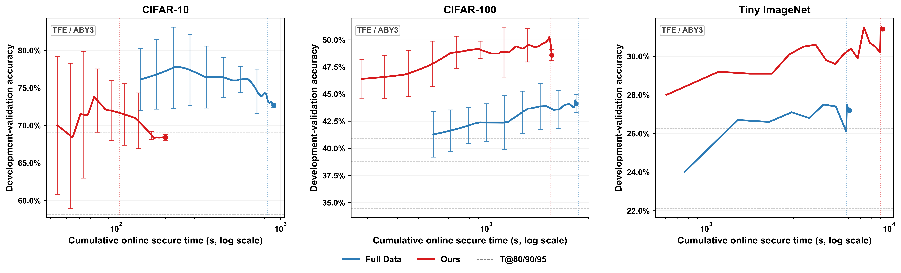
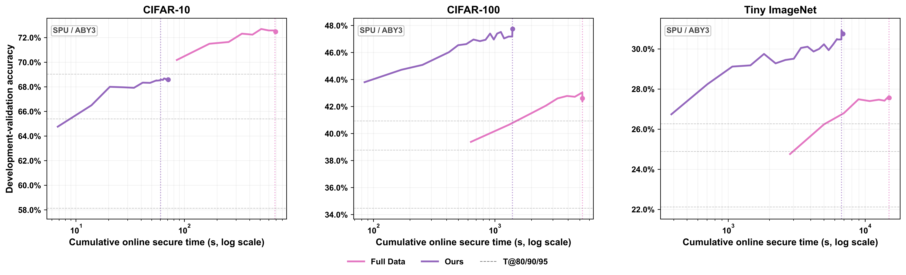
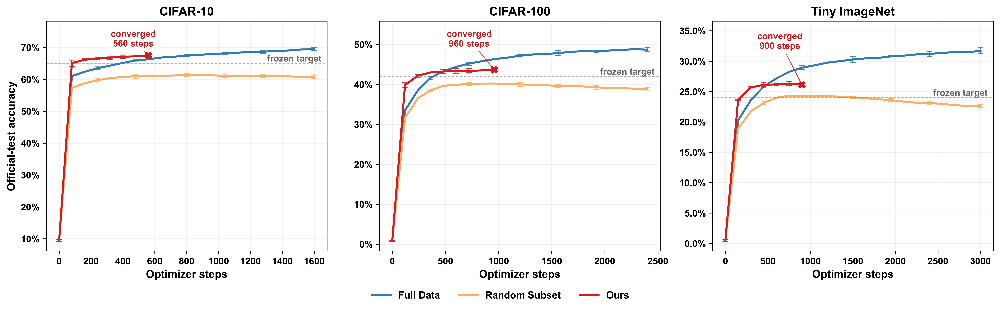
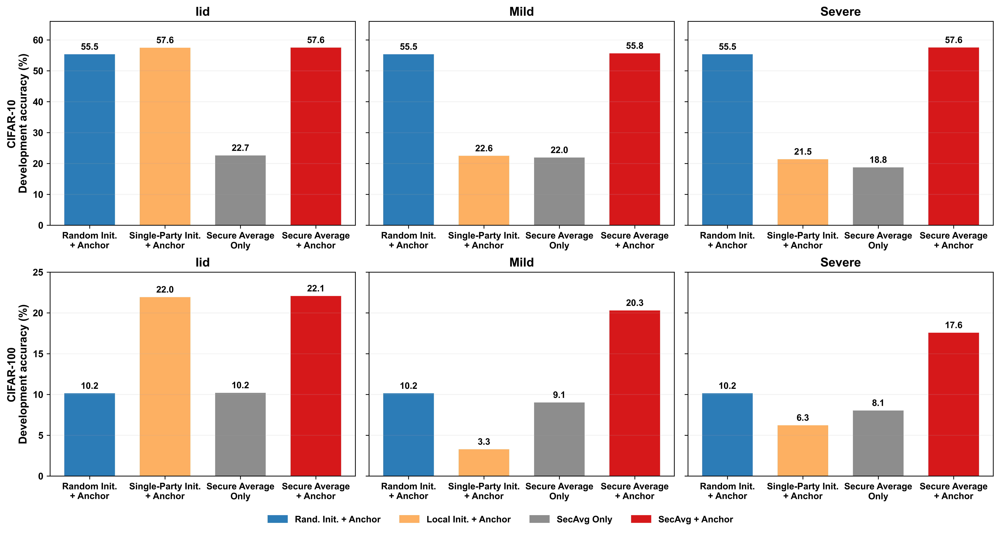
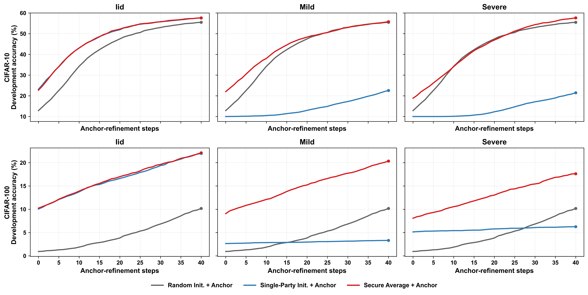
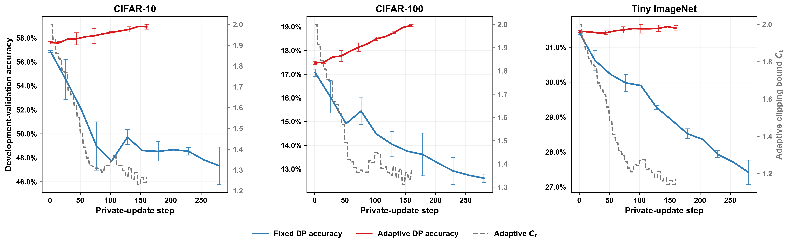

# Abstract

Secure multi-party computation (MPC)-based multi-party learning (MPL) enables parties to jointly train a model without exposing local data during computation. However, the released model may still reveal information about individual records, motivating differential privacy (DP). Combining DP with secret-sharing-based learning can increase training cost and impair model utility, limiting deployment on larger tasks.

To address this limitation, we propose a cross-stage optimization framework for differentially private MPL. The framework jointly optimizes the protected workload, global initialization, and private updates. Trajectory-matching dataset distillation constructs compact local training carriers, while lightweight models trained on secret-shared features are securely averaged and refined using class-balanced labeled anchors. Adaptive clipping adjusts the clipping bound according to gradient-norm statistics. The framework is implemented in TF Encrypted and SecretFlow and evaluated on CIFAR-10, CIFAR-100, and Tiny ImageNet. With 9.6% of CIFAR-100 training samples, the distilled carrier retains 89.8% of full-data accuracy. Under TFE/ABY3, the complete pipeline reduces the time required to reach 90% of matched Full Data accuracy by 60.5%, improves validation accuracy by 12.5%, and reduces total secure time by 30.4%. On SecretFlow-SPU, the time required to reach the same target decreases by up to 89.3% on CIFAR-10, corresponding to an 836% increase in training speed, with consistent reductions on the other datasets. These results demonstrate that cross-stage optimization improves secure-training efficiency and model utility.

**Keywords:** multi-party learning; secure multi-party computation; differential privacy; dataset distillation; secure global initialization; adaptive clipping.

# 摘要（中文翻译）

基于安全多方计算（MPC）的多方学习（MPL）使多个参与方能够在不暴露本地数据的情况下联合训练模型。然而，发布的模型仍可能泄露单条记录的信息，因此需要引入差分隐私（DP）。将 DP 与基于秘密共享的学习结合会增加训练成本并损害模型效用，从而限制其在更大规模任务上的部署。

为解决这一局限，我们提出一种面向差分隐私 MPL 的跨阶段优化框架。该框架协同优化受保护训练负载、全局初始化和私有更新。轨迹匹配数据集蒸馏用于构建紧凑的本地训练载体；随后，在秘密共享特征上训练的轻量模型经过安全平均，并利用类别平衡的带标签锚点进行修正。自适应裁剪根据梯度范数统计调整裁剪阈值。该框架在 TF Encrypted 和 SecretFlow 中实现，并在 CIFAR-10、CIFAR-100 和 Tiny ImageNet 上进行评估。仅使用 CIFAR-100 训练样本的 9.6%，蒸馏训练载体即可保留完整数据准确率的 89.8%。在 TFE/ABY3 下，完整流程将达到匹配 Full Data 准确率 90% 所需的时间减少 60.5%，将验证准确率提高 12.5%，并将安全训练总时间减少 30.4%。在 SecretFlow-SPU 上，CIFAR-10 达到相同目标所需的时间最多减少 89.3%，相当于训练速度提高 836%；其余数据集也呈现一致的时间缩减趋势。这些结果表明，跨阶段优化能够改善安全训练效率和模型效用。

**关键词：** 多方学习；安全多方计算；差分隐私；数据集蒸馏；安全全局初始化；自适应裁剪。

# Introduction

Predictive services in healthcare, finance, and online platforms increasingly depend on records held by independent organizations. Joint training could improve model coverage, yet sensitive records cannot usually be pooled because of regulatory and institutional constraints. Secure multi-party computation (MPC)-based multi-party learning (MPL) addresses this setting by evaluating training operations over secret-shared values. SecureML and SecureNN established practical protocols for protected learning [1], [2], while TF Encrypted and SecretFlow-SPU provide open-source execution frameworks [3], [4]. Computation privacy alone, however, does not prevent a released model from exposing whether a record participated in training [5]. Differential privacy (DP) supplies complementary output protection [6], commonly through the clipping and perturbation steps of DP-SGD [7].

Combining DP with secret-shared training introduces a coupled systems problem. Every protected sample increases arithmetic and communication, an unreliable initializer consumes additional private updates, and a mismatched clipping bound either discards useful gradient information or amplifies noise. Existing systems mainly optimize individual parts of this process; PEA, for example, combines feature extraction and local-model initialization with secure DP-SGD [8]. Nevertheless, protected workload, initialization quality, and private-update effectiveness jointly determine the cost of reaching useful accuracy.

To coordinate these factors, a cross-stage optimization framework is proposed. First, trajectory-matching dataset distillation constructs compact labeled carriers that reduce the number of samples entering protected computation [9]. Second, lightweight heads are trained on secret-shared representations, securely averaged, and refined with class-balanced labeled anchors to obtain a global initializer. Third, the clipping bound is adapted from protected gradient-norm statistics before calibrated perturbation is applied [12], [13]. The compact carrier supplies both initialization and private training data, while the refined initializer and adaptive optimizer reduce the burden of the remaining private updates.

The framework is implemented in TF Encrypted and SecretFlow-SPU and evaluated on CIFAR-10, CIFAR-100, and Tiny ImageNet. With 9.6% of the CIFAR-100 training samples, the compact carrier retains 89.8% of full-data accuracy. Under TFE/ABY3, time to the fixed utility target is reduced by 60.5%, validation accuracy is improved by 12.5%, and total secure time is reduced by 30.4%.

## Main Contributions

Our main contributions are summarized as follows:

1. We identify protected workload, heterogeneous initialization, and private-update utility as coupled bottlenecks and coordinate them within one differentially private MPL framework.
2. We construct trajectory-matched compact carriers and connect their class structure to secure global initialization.
3. We design secure parameter averaging with labeled-anchor refinement to integrate cross-party information before private training.
4. We develop adaptive private optimization and implement the complete workflow in TF Encrypted and SecretFlow-SPU.

# 引言（中文翻译）

医疗、金融和在线平台中的预测服务日益依赖由不同机构分别持有的数据记录。联合训练有望提高模型覆盖能力，但受监管要求和机构政策限制，敏感记录通常无法直接汇集。基于安全多方计算（MPC）的多方学习（MPL）通过在秘密共享数值上执行训练操作来支持此类协作。SecureML 和 SecureNN 为受保护学习建立了实用协议 [1], [2]，TF Encrypted 与 SecretFlow-SPU 则提供了开源执行框架 [3], [4]。然而，仅保护计算过程并不能阻止发布模型泄露某条记录是否参与训练 [5]。差分隐私（DP）提供了互补的输出保护 [6]，通常通过 DP-SGD 中的梯度裁剪和扰动实现 [7]。

将 DP 与秘密共享训练结合后，会形成一个相互耦合的系统问题。每个受保护样本都会增加算术与通信开销；不可靠的初始化模型会消耗更多私有更新；不匹配的裁剪阈值则可能丢弃有效梯度信息或放大噪声。现有系统主要优化训练流程中的单独环节，例如 PEA 将特征提取、本地模型初始化与安全 DP-SGD 相结合 [8]。然而，受保护工作负载、初始化质量和私有更新有效性会共同决定达到可用准确率所需的成本。

为协调这些因素，本文提出一个跨阶段优化框架。首先，通过轨迹匹配数据集蒸馏构建紧凑带标签载体，从而减少进入受保护计算的样本数量 [9]。其次，在秘密共享表示上训练轻量分类头，对其参数进行安全平均，并使用类别平衡的带标签 Anchor 修正聚合结果，以获得全局初始化模型。最后，根据受保护梯度范数统计量自适应调整裁剪阈值，再施加校准扰动 [12], [13]。紧凑载体同时为初始化和私有训练提供数据，而修正后的初始化模型与自适应优化器共同降低后续私有更新负担。

该框架在 TF Encrypted 和 SecretFlow-SPU 中实现，并在 CIFAR-10、CIFAR-100 和 Tiny ImageNet 上进行评估。CIFAR-100 上仅使用 9.6% 的训练样本，紧凑载体即可保留完整数据准确率的 89.8%。在 TFE/ABY3 中，达到固定效用目标的时间减少 60.5%，验证准确率提高 12.5%，总安全时间减少 30.4%。

## 主要贡献

本文的主要贡献如下：

1. 本文识别出受保护工作负载、异构初始化和私有更新效用三个相互耦合的瓶颈，并在统一的差分隐私 MPL 框架中对其进行协调。
2. 本文构建轨迹匹配紧凑载体，并将其类别结构用于安全全局初始化。
3. 本文设计安全参数平均与带标签 Anchor 修正，在私有训练前整合跨方信息。
4. 本文设计自适应私有优化方法，并在 TF Encrypted 和 SecretFlow-SPU 中实现完整流程。

# Related Work

## 2.1 MPC-Based Multi-Party Learning

Secure multi-party computation (MPC) evaluates functions over private inputs while revealing only the prescribed output [14], [15]. SecureML, SecureNN, and ABY3 provide protected primitives for neural-network training [1], [2], [38], while TF Encrypted and SecretFlow-SPU expose higher-level MPC programming interfaces [3], [4]. CryptGPU accelerates three-party training with GPU-MPC [41]; Hercules and POSEIDON instead use multiparty homomorphic encryption for collaborative neural-network training [43], [44]. These systems improve protected execution, but fixed-point arithmetic, nonlinear operations, and communication remain costly.

MPC-based MPL differs from federated learning (FL). FedAvg performs local optimization in plaintext and exchanges model updates [17], [18], while secure aggregation hides individual updates but normally reveals their aggregate [16]. MPL can retain data, parameters, gradients, and global optimization as secret shares. Although local data preparation resembles FL, the protected global computation studied here follows the MPL trust and execution model.

## 2.2 Differential Privacy in Secure Learning

Differential privacy (DP) limits the influence of one record on a randomized output [6]. DP-SGD clips per-example gradients, adds Gaussian noise, and composes repeated accesses through privacy accounting [7], [19]-[21]. Utility depends on the clipping bound: a small value increases clipping bias, whereas a large value increases sensitivity and noise [24]. AdaCliP, quantile-based clipping, and automatic clipping adapt this bound or normalize updates [12], [22], [23]. Under MPC, norm estimation, comparisons, clipping, and perturbation must also be evaluated securely.

Distributed mechanisms combine secure aggregation with discrete Gaussian, Poisson binomial, or jointly generated noise [13], [16], [36], [37]. PATE protects released predictions through noisy teacher aggregation [31], while FLDP combines malicious-secure aggregation with DP for federated learning [42]. PEA incorporates secure DP-SGD, feature extraction, and model initialization into secret-sharing-based MPL [8]. Existing work demonstrates that MPC and DP are complementary, but usually optimizes the protected workload, initializer, or private update in isolation.

## 2.3 Dataset Distillation

Coreset selection retains existing records [25], whereas dataset distillation synthesizes a smaller set that reproduces full-data training behavior [26]. Existing objectives match gradients, kernel solutions, or augmented examples [27]-[29]. Matching Training Trajectories (MTT) aligns multi-step parameter trajectories [9], and DC-BENCH shows that its utility depends on compression, architecture, and augmentation [30].

Distillation is usually evaluated by plaintext accuracy. In MPL, it can additionally reduce the number of records entering secure computation, unlike feature compression that retains the original sample count. Synthetic data are not automatically private, however, and system savings cannot be inferred from plaintext utility alone. Both the construction boundary and protected workload must therefore be evaluated.

## 2.4 Secure Global Initialization and Anchor-Based Refinement

Non-IID data can make parameter averaging an unstable initializer even when aggregation is protected [16]-[18]. Prediction-level alternatives use knowledge distillation or shared representations to coordinate heterogeneous participants, including FedMD, FedDF, Federated Distillation, FedKD, and group knowledge transfer [10], [11], [32]-[35].

The present method assumes a shared lightweight head architecture. Secret-shared local parameters are averaged and then refined on disjoint, class-balanced labeled anchors. This operation uses hard-label cross-entropy rather than teacher probabilities, temperature scaling, or a distillation loss. It is therefore supervised initializer refinement, not knowledge distillation.

# 相关工作（中文翻译）

## 2.1 基于 MPC 的多方学习

安全多方计算（MPC）能够在私有输入上执行函数，仅公开规定输出 [14], [15]。SecureML、SecureNN 和 ABY3 为神经网络训练提供受保护计算原语 [1], [2], [38]，TF Encrypted 与 SecretFlow-SPU 则提供更高层的 MPC 编程接口 [3], [4]。CryptGPU 利用 GPU-MPC 加速三方训练 [41]；Hercules 和 POSEIDON 则采用多方同态加密实现协同神经网络训练 [43], [44]。这些系统提高了受保护计算效率，但定点运算、非线性操作和通信仍然昂贵。

基于 MPC 的 MPL 不同于联邦学习（FL）。FedAvg 在本地以明文优化并交换模型更新 [17], [18]，安全聚合隐藏单方更新，但通常公开聚合结果 [16]。MPL 可以使数据、参数、梯度和全局优化始终保持秘密共享状态。尽管本地数据准备在形式上类似 FL，本文的全局受保护计算仍遵循 MPL 的信任与执行模型。

## 2.2 安全学习中的差分隐私

差分隐私（DP）限制单条记录对随机化输出的影响 [6]。DP-SGD 裁剪单样本梯度、加入高斯噪声，并通过隐私会计组合重复访问 [7], [19]-[21]。裁剪阈值过小会增加裁剪偏差，过大则会提高敏感度和噪声 [24]。AdaCliP、分位数裁剪和 Automatic Clipping 对阈值进行调整或归一化更新 [12], [22], [23]。在 MPC 环境中，范数估计、比较、裁剪和扰动还必须安全执行。

分布式机制将安全聚合与离散高斯、Poisson Binomial 或联合噪声生成相结合 [13], [16], [36], [37]。PATE 通过带噪教师聚合保护发布预测 [31]，FLDP 将恶意安全聚合与联邦学习中的 DP 相结合 [42]。PEA 则在秘密共享 MPL 中结合安全 DP-SGD、特征提取和模型初始化 [8]。现有工作证明 MPC 与 DP 可以互补，但通常只单独优化受保护工作负载、初始化模型或私有更新。

## 2.3 数据集蒸馏

Coreset 选择保留已有记录 [25]，数据集蒸馏则合成能够复现完整数据训练行为的小型数据集 [26]。现有目标包括梯度匹配、核方法和增强样本匹配 [27]-[29]。MTT 对齐多步参数轨迹 [9]，DC-BENCH 进一步表明其效用受到压缩率、架构和增强策略影响 [30]。

数据集蒸馏通常以明文准确率评价。在 MPL 中，它还可以减少进入安全计算的记录数量，这不同于仍保留原始样本数的特征压缩。然而，合成数据不会自动获得隐私保护，系统收益也不能仅由明文效用推断。因此，数据构建边界和受保护工作负载均需验证。

## 2.4 安全全局初始化与基于 Anchor 的修正

non-IID 数据可能使参数平均产生不稳定的初始化，即使聚合过程受到保护 [16]-[18]。基于预测的方法则利用知识蒸馏或共享表示协调异构参与方，包括 FedMD、FedDF、Federated Distillation、FedKD 和 Group Knowledge Transfer [10], [11], [32]-[35]。

本文假设各方采用共享的轻量分类头架构。秘密共享的本地参数先被平均，再利用彼此独立且类别平衡的带标签 Anchor 修正。该过程使用硬标签交叉熵，不涉及教师概率、温度缩放或蒸馏损失，因此属于监督式初始化修正，而非知识蒸馏。

# 3. Overview

## 3.1 System Participants and Workflow

The system consists of $m$ data owners $P_1,\ldots,P_m$, MPC computing parties $C_1,\ldots,C_q$, and a model user $U$. Owner $P_i$ holds $D_i=\{(x_{i,n},y_{i,n})\}_{n=1}^{N_i}$ and constructs a compact distilled carrier $D_i^{\mathrm{syn}}$ locally. A shared frozen encoder $\phi$ produces labeled representations $\mathcal{Z}_i=\{(\phi(x_{i,j}^{\mathrm{syn}}),y_{i,j}^{\mathrm{syn}})\}$, partitioned into local-head training records and disjoint labeled anchors. The user receives only the authorized model $\theta^*$.

Local distillation and encoding operate on plaintext inside each owner's trusted environment. Features and labels are then secret-shared as $\langle\mathcal{Z}_i\rangle$ for TF Encrypted or SecretFlow-SPU [3], [4]. Secure global initialization trains lightweight heads, averages their parameters, and refines the aggregate on labeled anchors to produce $\langle\theta_B\rangle$. Adaptive private optimization starts from this initializer, computes protected per-example gradients, adjusts $C_t$, adds calibrated noise, and retains $\langle\theta_T\rangle$ as shares until authorized reconstruction [7], [12], [13]. Under three-party ABY3, every protected value is distributed among three computing parties [38]. Figure 1 summarizes this execution boundary and the connected data and model flows.

**Figure 1. System model and cross-stage workflow.**

## 3.2 Threat Model and Privacy Goals

A semi-honest threat model is considered. Data owners and computing parties follow the protocol but may inspect their views to infer private information. The tolerated collusion follows the selected backend; three-party ABY3 assumes an honest majority and tolerates one corrupted computing party [38]. Active deviations, poisoning, denial of service, side channels, and stronger collusion are outside scope. The model user may inspect $\theta^*$ and attempt membership inference [5].

MPC protects compact records, anchors, parameters, gradients, clipping statistics, noise, and intermediate updates during computation [14], [15]. DP instead limits one protected training record's influence on the released model through clipping, calibrated perturbation, and accounting [6], [7]. The declared $(\epsilon,\delta)$ applies to adaptive private optimization over the compact records. Local distillation and anchor refinement do not automatically provide record-level DP; extending the guarantee to source records requires private distillation, a stability relation, or explicit composition across all data-dependent preparation.

# 第三章 概述（中文翻译）

## 3.1 系统参与方与工作流程

系统由 $m$ 个数据持有方 $P_1,\ldots,P_m$、MPC 计算方 $C_1,\ldots,C_q$ 和模型使用者 $U$ 构成。数据持有方 $P_i$ 拥有 $D_i=\{(x_{i,n},y_{i,n})\}_{n=1}^{N_i}$，并在本地构建紧凑蒸馏载体 $D_i^{\mathrm{syn}}$。共享冻结编码器 $\phi$ 产生带标签表示 $\mathcal{Z}_i=\{(\phi(x_{i,j}^{\mathrm{syn}}),y_{i,j}^{\mathrm{syn}})\}$，并将其划分为本地分类头训练记录和相互独立的带标签 Anchor。模型使用者仅接收授权模型 $\theta^*$。

本地数据蒸馏和编码在各数据持有方的可信环境中以明文执行，随后特征与标签被秘密共享为 $\langle\mathcal{Z}_i\rangle$，供 TF Encrypted 或 SecretFlow-SPU 处理 [3], [4]。安全全局初始化训练轻量分类头、平均其参数，并利用带标签 Anchor 修正聚合结果，得到 $\langle\theta_B\rangle$。自适应私有优化从该模型出发，计算受保护的单样本梯度、调整 $C_t$、加入校准噪声，并使 $\langle\theta_T\rangle$ 保持为秘密份额直至授权重构 [7], [12], [13]。在三方 ABY3 下，每个受保护值被分布在三个计算方之间 [38]。图 1 汇总了执行边界以及相互连接的数据流与模型流。

**图 1. 系统模型与跨阶段工作流程。**

## 3.2 威胁模型与隐私目标

本文采用半诚实威胁模型。数据持有方和计算方遵循协议，但可能检查其视图以推断私有信息。可容忍串谋由所选后端决定；三方 ABY3 假设诚实多数，并允许一个计算方被腐化 [38]。主动偏离、投毒、拒绝服务、侧信道和更强串谋不在讨论范围。模型使用者可能检查 $\theta^*$ 并发起成员推断攻击 [5]。

MPC 在计算过程中保护紧凑记录、Anchor、参数、梯度、裁剪统计量、噪声和中间更新 [14], [15]。DP 则通过裁剪、校准扰动和隐私会计，限制单条受保护训练记录对发布模型的影响 [6], [7]。声明的 $(\epsilon,\delta)$ 适用于紧凑记录上的自适应私有优化。本地蒸馏和 Anchor 修正不会自动提供记录级 DP；若要把保证扩展至源数据记录，还需要私有蒸馏、稳定性关系或覆盖全部数据依赖准备过程的显式组合。

# 4. Methodology

## 4.1 Compact Labeled Representation Construction

Compact-data construction replaces owner $P_i$'s dataset $D_i$ with a smaller labeled synthetic set $D_i^{\mathrm{syn}}=\{(x_{i,j}^{\mathrm{syn}},y_{i,j}^{\mathrm{syn}})\}_{j=1}^{S_i}$, where $S_i\ll N_i$. The set matches the optimization trajectory induced by synthetic samples to an expert trajectory from $D_i$ [9]. Let $w_{i,t}^{E}$ and $w_{i,t+K}^{E}$ denote two expert checkpoints. Starting from $w_{i,t}^{E}$, $J$ synthetic updates produce $\hat{w}_{i,t+J}$. The samples minimize Eq. (1)

$$
\mathcal{L}_{\mathrm{MTT}}(D_i^{\mathrm{syn}})=
\mathbb{E}_{t}
\left[
\frac{\|\hat{w}_{i,t+J}-w_{i,t+K}^{E}\|_2^2}
{\|w_{i,t}^{E}-w_{i,t+K}^{E}\|_2^2+\xi}
\right],
\tag{1}
$$

where $\xi>0$ prevents numerical instability. This objective preserves training behavior rather than selecting existing records, allowing the number of samples entering protected computation to be reduced directly.

A common encoder $\phi$ is fixed before global protected training and used by every owner. Each synthetic image is mapped to $\tilde{z}_{i,j}=\phi(x_{i,j}^{\mathrm{syn}})$. Using normalization parameters associated with the shared encoder, the resulting feature is standardized and norm-bounded according to Eq. (2)

$$
z_{i,j}=\bar{z}_{i,j}\min\left(1,\frac{R}{\|\bar{z}_{i,j}\|_2+\tau}\right),
\tag{2}
$$

where $R$ is the public feature-norm bound and $\tau$ is a small constant. The output is a compact labeled representation set $\mathcal{Z}_i=\{(z_{i,j},y_{i,j}^{\mathrm{syn}})\}$. A class-balanced partition produces a local training subset $\mathcal{Z}_i^{\mathrm{tr}}$ and a disjoint labeled-anchor subset $\mathcal{Z}_i^{\mathrm{anc}}$. Features and labels from both subsets are secret-shared before leaving $P_i$; raw samples and distilled images remain in the local domain.

## 4.2 Secure Global Initialization

Secure global initialization learns a lightweight classification head on the frozen representation. Let $h_{\theta}(z)=zW+b$, where $\theta=(W,b)$. All local heads start from the same public initialization $\theta_0$. For each owner, the computing parties minimize Eq. (3) over secret shares:

$$
\mathcal{L}_i(\theta)=\frac{1}{|\mathcal{Z}_i^{\mathrm{tr}}|}
\sum_{(z,y)\in\mathcal{Z}_i^{\mathrm{tr}}}
\operatorname{CE}(\operatorname{softmax}(h_{\theta}(z)),y)
+\frac{\lambda_w}{2}\|W\|_2^2,
\tag{3}
$$

and obtain $\langle\theta_i\rangle$ without reconstructing the local features, labels, gradients, or parameters. The local heads share the same architecture and are combined by the secure parameter average in Eq. (4).

$$
\langle\bar{\theta}\rangle=\frac{1}{m}\sum_{i=1}^{m}\langle\theta_i\rangle.
\tag{4}
$$

Parameter averaging transfers information from all owners, but its prediction boundary may remain biased when the local distributions differ. The union of the disjoint anchor contributions, $\mathcal{Z}^{\mathrm{anc}}=\bigcup_i\mathcal{Z}_i^{\mathrm{anc}}$, is therefore used to refine the averaged head with hard-label supervision. Starting from $\theta_B^{(0)}=\bar{\theta}$, the protected refinement minimizes Eq. (5)

$$
\mathcal{L}_{\mathrm{anc}}(\theta)=
\frac{1}{|\mathcal{Z}^{\mathrm{anc}}|}
\sum_{(z,y)\in\mathcal{Z}^{\mathrm{anc}}}
\operatorname{CE}(\operatorname{softmax}(h_{\theta}(z)),y)
+\mu\|\theta-\bar{\theta}\|_2^2.
\tag{5}
$$

The optional proximal term controls excessive deviation from the cross-party average. This is supervised post-aggregation refinement: no teacher logits, temperature parameter, or distillation loss is introduced.

> **Protocol 1: Secure Global Initialization**  
> **Input:** $\{\langle\mathcal{Z}_i^{\mathrm{tr}}\rangle,\langle\mathcal{Z}_i^{\mathrm{anc}}\rangle\}_{i=1}^{m}$, public $\theta_0$, local learning rate $\eta_L$, local rounds $E_L$, refinement rate $\eta_B$, refinement steps $R_B$, and $\mu$.  
> **Output:** Refined initializer $\langle\theta_B\rangle$.  
> 1. For every $P_i$, initialize $\langle\theta_i\rangle\leftarrow\theta_0$ and perform $E_L$ secure gradient updates on $\langle\mathcal{Z}_i^{\mathrm{tr}}\rangle$.  
> 2. Compute $\langle\bar{\theta}\rangle\leftarrow m^{-1}\sum_i\langle\theta_i\rangle$.  
> 3. Set $\langle\theta_B^{(0)}\rangle\leftarrow\langle\bar{\theta}\rangle$ and logically concatenate the secret-shared anchor subsets.  
> 4. For $r=0,\ldots,R_B-1$, compute $\langle g_r\rangle=\nabla_{\theta}\mathcal{L}_{\mathrm{anc}}(\langle\theta_B^{(r)}\rangle)$ and update $\langle\theta_B^{(r+1)}\rangle\leftarrow\langle\theta_B^{(r)}\rangle-\eta_B\langle g_r\rangle$.  
> 5. Return $\langle\theta_B\rangle=\langle\theta_B^{(R_B)}\rangle$ without reconstruction.

## 4.3 Secure Adaptive Private Optimization

Adaptive private optimization starts from $\langle\theta_B\rangle$ and uses $\mathcal{Z}^{\mathrm{opt}}=\bigcup_i\mathcal{Z}_i^{\mathrm{tr}}$. At iteration $t$, it samples $\mathcal{B}_t$ and computes each per-example gradient according to Eq. (6).

$$
\langle g_{t,j}\rangle=\nabla_{\theta}\ell(\langle\theta_t\rangle;\langle z_j,y_j\rangle).
\tag{6}
$$

Instead of using one fixed clipping threshold throughout training, the mechanism tracks a target quantile of the protected gradient-norm distribution [12]. Let $b_{t,j}=\mathbb{I}[\|g_{t,j}\|_2\le C_t]$. The noised fraction is computed by Eq. (7):

$$
\tilde{q}_t=\operatorname{clip}_{[0,1]}
\left(\frac{1}{|\mathcal{B}_t|}\sum_j b_{t,j}+\nu_t\right),
\qquad
\nu_t\sim\mathcal{N}\left(0,\frac{\sigma_c^2}{|\mathcal{B}_t|^2}\right).
\tag{7}
$$

After an optional warm-up period and at a prescribed update interval, the clipping bound is adjusted according to Eq. (8):

$$
C_{t+1}=\operatorname{clip}_{[C_{\min},C_{\max}]}
\left(C_t\exp\big(\eta_C(\gamma-\tilde{q}_t)\big)\right),
\tag{8}
$$

where $\gamma$ is the target fraction. Thus, the bound increases when too few gradients fall below $C_t$ and decreases when the observed fraction is larger than required. Between adaptation points, $C_{t+1}=C_t$.

Each gradient is clipped under secret sharing according to Eq. (9).

$$
\bar{g}_{t,j}=g_{t,j}\min\left(1,\frac{C_t}{\|g_{t,j}\|_2+\tau}\right),
\tag{9}
$$

The resulting private update is given by Eq. (10).

$$
\tilde{g}_t=\frac{1}{|\mathcal{B}_t|}\left(
\sum_j\bar{g}_{t,j}+\mathcal{N}(0,\sigma_g^2C_t^2I)
\right),
\qquad
\theta_{t+1}=\theta_t-\eta_t\tilde{g}_t.
\tag{10}
$$

Independent contributions from the computing parties generate the Gaussian noise, preventing one party from controlling the perturbation [13]. The accountant composes the sampled Gaussian gradient mechanism and noised clipping-count queries through Rényi DP [19], [20]. The reported $(\epsilon,\delta)$ therefore follows the boundary in Section 3.2.

> **Protocol 2: Secure Adaptive Private Optimization**  
> **Input:** $\langle\theta_B\rangle$, $\langle\mathcal{Z}^{\mathrm{opt}}\rangle$, steps $T$, sampling rate $q$, learning rates $\{\eta_t\}$, $C_0$, $C_{\min}$, $C_{\max}$, $\gamma$, $\eta_C$, $\sigma_g$, and $\sigma_c$.  
> **Output:** Final model shares $\langle\theta_T\rangle$ and the composed private-optimization cost.  
> 1. Set $\langle\theta_0\rangle\leftarrow\langle\theta_B\rangle$ and $\langle C_0\rangle\leftarrow C_0$.  
> 2. For $t=0,\ldots,T-1$, sample $\mathcal{B}_t$ and securely compute all $\langle g_{t,j}\rangle$ and their squared norms.  
> 3. At an adaptation point, securely evaluate the noised fraction $\langle\tilde q_t\rangle$ and update $\langle C_{t+1}\rangle$; otherwise retain $\langle C_t\rangle$.  
> 4. Securely clip the per-example gradients with $C_t$ and aggregate them.  
> 5. Generate distributed Gaussian noise, add it to the aggregate, and update $\langle\theta_{t+1}\rangle$.  
> 6. Compose the gradient and clipping-count mechanisms in the privacy accountant.  
> 7. Return $\langle\theta_T\rangle$; reconstruct only at the authorized output boundary.

## 4.4 Security and Cost Analysis

**Computation privacy.** Protocols 1 and 2 use only secure arithmetic, comparison, and random-generation functionalities. Features, labels, parameters, gradients, clipping values, and noise contributions remain secret-shared. Under the selected backend's semi-honest corruption threshold, sequential composition reveals only the prescribed output [14], [15]. Three-party ABY3 tolerates one corrupted computing party [38]. Secure fixed-point approximation may affect numerical accuracy but not this privacy argument.

**Private-output guarantee.** Consider neighboring compact training sets differing in one record of $\mathcal{Z}^{\mathrm{opt}}$, conditioned on $\theta_B$. Clipping bounds that record's gradient contribution, while Gaussian noise protects the update [7]. The clipping statistic is also perturbed. If $T$ gradient steps and $T_C$ threshold adaptations have respective order-$\alpha$ RDP costs $\varepsilon_g^{(\alpha)}$ and $\varepsilon_c^{(\alpha)}$, the accountant gives Eq. (11):

$$
\epsilon_C(\delta)=\min_{\alpha>1}\left[
T\varepsilon_g^{(\alpha)}+T_C\varepsilon_c^{(\alpha)}
+\frac{\log(1/\delta)}{\alpha-1}
\right].
\tag{11}
$$

RDP composition and conversion yield $(\epsilon_C,\delta)$-DP for Protocol 2 [19], [20]; subsequent threshold updates and reconstruction are post-processing. This guarantee composes with the privacy status of $\theta_B$. When the initializer depends on non-private preparation, $\epsilon_C$ remains conditional on that initializer, as specified in Section 3.2.

**Protected computation cost.** Let $d$ be the representation dimension, $K$ the class count, $S_{\mathrm{tr}}=\sum_i|\mathcal{Z}_i^{\mathrm{tr}}|$, and $S_{\mathrm{anc}}=\sum_i|\mathcal{Z}_i^{\mathrm{anc}}|$. With $E_L$ local rounds and $R_B$ refinement steps, secure initialization costs

$$
\mathsf{Cost}_B=O(E_LS_{\mathrm{tr}}dK+R_BS_{\mathrm{anc}}dK).
\tag{12}
$$

For expected minibatch size $B$, $T$ private updates cost

$$
\mathsf{Cost}_C=O(TBdK)+\mathsf{Cost}_{\mathrm{norm}}
+\mathsf{Cost}_{\mathrm{adapt}}+O(TdK),
\tag{13}
$$

where the remaining terms cover secure norm statistics, adaptation, noise generation, and model updates. Distillation and encoding are local costs. If $N=\sum_iN_i$ and $\rho=(S_{\mathrm{tr}}+S_{\mathrm{anc}})/N$, compact-data construction reduces the protected records to fraction $\rho$. Secure initialization aims to reduce $T_{\mathrm{target}}$, while adaptive clipping adds bounded overhead. The resulting online cost is

$$
\mathsf{Cost}_{\mathrm{secure}}\approx
\mathsf{Cost}_B(S_{\mathrm{tr}},S_{\mathrm{anc}})
+T_{\mathrm{target}}\,\mathsf{Cost}_{\mathrm{private\ step}}(B,d,K)
+\mathsf{Cost}_{\mathrm{adapt}}.
\tag{14}
$$

Actual time, communication, and memory depend on fixed-point precision and backend primitives, and are measured empirically.

## 4.5 Cross-Stage Training Procedure

Algorithm 1 connects the compact carrier, refined initializer, and adaptive private optimizer in one protected workflow.

> **Algorithm 1: Cross-Stage Training for Differentially Private MPL**  
> **Input:** Private datasets $\{D_i\}_{i=1}^{m}$, shared encoder $\phi$, distillation budget $S_i$, initialization and private-optimization hyperparameters, and target $(\epsilon,\delta)$.  
> **Output:** Authorized global model $\theta^*$.  
> 1. Each owner independently constructs $D_i^{\mathrm{syn}}$ by trajectory matching.  
> 2. Each owner encodes and norm-bounds its distilled samples, partitions $\mathcal{Z}_i$ into $\mathcal{Z}_i^{\mathrm{tr}}$ and $\mathcal{Z}_i^{\mathrm{anc}}$, and secret-shares their features and labels.  
> 3. The computing parties invoke Protocol 1 to obtain $\langle\theta_B\rangle$.  
> 4. Calibrate $\sigma_g$ and $\sigma_c$ for the declared private-optimization budget and invoke Protocol 2 on $\langle\mathcal{Z}^{\mathrm{opt}}\rangle$.  
> 5. After $T$ protected updates, obtain $\langle\theta_T\rangle$ and verify the composed privacy cost.  
> 6. Authorized computing parties reconstruct $\theta^*$ for model user $U$; all other protected values remain unrevealed.

# 第四章 方法（中文翻译）

## 4.1 紧凑带标签表示构建

紧凑数据构建使用规模更小的带标签合成集 $D_i^{\mathrm{syn}}=\{(x_{i,j}^{\mathrm{syn}},y_{i,j}^{\mathrm{syn}})\}_{j=1}^{S_i}$ 替代数据持有方 $P_i$ 的完整数据集 $D_i$，其中 $S_i\ll N_i$。该数据集匹配合成样本产生的优化轨迹与 $D_i$ 的专家轨迹 [9]。令 $w_{i,t}^{E}$ 和 $w_{i,t+K}^{E}$ 表示两个专家检查点。从 $w_{i,t}^{E}$ 出发，执行 $J$ 次合成数据更新得到 $\hat{w}_{i,t+J}$。蒸馏样本最小化式（1）：

$$
\mathcal{L}_{\mathrm{MTT}}(D_i^{\mathrm{syn}})=
\mathbb{E}_{t}
\left[
\frac{\|\hat{w}_{i,t+J}-w_{i,t+K}^{E}\|_2^2}
{\|w_{i,t}^{E}-w_{i,t+K}^{E}\|_2^2+\xi}
\right],
\tag{1}
$$

其中，$\xi>0$ 用于防止数值不稳定。该目标保留训练行为，而不是从现有记录中选择样本，因此能够直接减少进入受保护计算的样本数量。

公共编码器 $\phi$ 在全局受保护训练前被固定，并由所有数据持有方共同使用。每个合成图像被映射为 $\tilde{z}_{i,j}=\phi(x_{i,j}^{\mathrm{syn}})$。利用与公共编码器配套的归一化参数，对所得特征按照式（2）进行标准化和范数约束：

$$
z_{i,j}=\bar{z}_{i,j}\min\left(1,\frac{R}{\|\bar{z}_{i,j}\|_2+\tau}\right),
\tag{2}
$$

其中，$R$ 为公开的特征范数上界，$\tau$ 为一个较小常数。最终输出紧凑带标签表示集 $\mathcal{Z}_i=\{(z_{i,j},y_{i,j}^{\mathrm{syn}})\}$。按照类别平衡原则，将其划分为本地训练子集 $\mathcal{Z}_i^{\mathrm{tr}}$ 和与其互不重叠的带标签 Anchor 子集 $\mathcal{Z}_i^{\mathrm{anc}}$。两个子集的特征与标签在离开 $P_i$ 前均被转换为秘密份额；原始样本和蒸馏图像始终保留在本地域内。

## 4.2 安全全局初始化

安全全局初始化仅在冻结表示之上学习轻量分类头。令 $h_{\theta}(z)=zW+b$，其中 $\theta=(W,b)$。所有本地分类头均从相同的公开参数 $\theta_0$ 开始。对于每个数据持有方，计算方在秘密份额上最小化式（3）：

$$
\mathcal{L}_i(\theta)=\frac{1}{|\mathcal{Z}_i^{\mathrm{tr}}|}
\sum_{(z,y)\in\mathcal{Z}_i^{\mathrm{tr}}}
\operatorname{CE}(\operatorname{softmax}(h_{\theta}(z)),y)
+\frac{\lambda_w}{2}\|W\|_2^2,
\tag{3}
$$

并在不重构本地特征、标签、梯度或参数的情况下得到 $\langle\theta_i\rangle$。本地分类头采用相同架构，并通过式（4）所示的安全参数平均进行组合：

$$
\langle\bar{\theta}\rangle=\frac{1}{m}\sum_{i=1}^{m}\langle\theta_i\rangle.
\tag{4}
$$

参数平均可以迁移所有数据持有方的信息，但在本地分布不同时，其预测边界仍可能存在偏差。因此，使用互不重叠的 Anchor 贡献之并集 $\mathcal{Z}^{\mathrm{anc}}=\bigcup_i\mathcal{Z}_i^{\mathrm{anc}}$，通过硬标签监督修正平均分类头。从 $\theta_B^{(0)}=\bar{\theta}$ 出发，受保护修正过程最小化式（5）：

$$
\mathcal{L}_{\mathrm{anc}}(\theta)=
\frac{1}{|\mathcal{Z}^{\mathrm{anc}}|}
\sum_{(z,y)\in\mathcal{Z}^{\mathrm{anc}}}
\operatorname{CE}(\operatorname{softmax}(h_{\theta}(z)),y)
+\mu\|\theta-\bar{\theta}\|_2^2.
\tag{5}
$$

其中，可选的近端项用于限制模型过度偏离跨方平均参数。该过程属于聚合后的监督修正：不引入教师 logits、温度参数或蒸馏损失。

> **协议 1：安全全局初始化**  
> **输入：** $\{\langle\mathcal{Z}_i^{\mathrm{tr}}\rangle,\langle\mathcal{Z}_i^{\mathrm{anc}}\rangle\}_{i=1}^{m}$、公开参数 $\theta_0$、本地学习率 $\eta_L$、本地训练轮数 $E_L$、修正学习率 $\eta_B$、修正步数 $R_B$ 以及 $\mu$。  
> **输出：** 修正后的初始化模型 $\langle\theta_B\rangle$。  
> 1. 对每个 $P_i$，令 $\langle\theta_i\rangle\leftarrow\theta_0$，并在 $\langle\mathcal{Z}_i^{\mathrm{tr}}\rangle$ 上执行 $E_L$ 次安全梯度更新。  
> 2. 计算 $\langle\bar{\theta}\rangle\leftarrow m^{-1}\sum_i\langle\theta_i\rangle$。  
> 3. 令 $\langle\theta_B^{(0)}\rangle\leftarrow\langle\bar{\theta}\rangle$，并在逻辑上拼接各秘密共享 Anchor 子集。  
> 4. 对 $r=0,\ldots,R_B-1$，计算 $\langle g_r\rangle=\nabla_{\theta}\mathcal{L}_{\mathrm{anc}}(\langle\theta_B^{(r)}\rangle)$，并更新 $\langle\theta_B^{(r+1)}\rangle\leftarrow\langle\theta_B^{(r)}\rangle-\eta_B\langle g_r\rangle$。  
> 5. 在不进行重构的情况下返回 $\langle\theta_B\rangle=\langle\theta_B^{(R_B)}\rangle$。

## 4.3 安全自适应私有优化

自适应私有优化从 $\langle\theta_B\rangle$ 出发，并使用 $\mathcal{Z}^{\mathrm{opt}}=\bigcup_i\mathcal{Z}_i^{\mathrm{tr}}$。在第 $t$ 次迭代中，采样小批量 $\mathcal{B}_t$，并按照式（6）计算各单样本梯度：

$$
\langle g_{t,j}\rangle=\nabla_{\theta}\ell(\langle\theta_t\rangle;\langle z_j,y_j\rangle).
\tag{6}
$$

该机制不在整个训练过程中使用单一固定裁剪阈值，而是跟踪受保护梯度范数分布的目标分位数 [12]。令 $b_{t,j}=\mathbb{I}[\|g_{t,j}\|_2\le C_t]$，带噪比例按照式（7）计算：

$$
\tilde{q}_t=\operatorname{clip}_{[0,1]}
\left(\frac{1}{|\mathcal{B}_t|}\sum_j b_{t,j}+\nu_t\right),
\qquad
\nu_t\sim\mathcal{N}\left(0,\frac{\sigma_c^2}{|\mathcal{B}_t|^2}\right).
\tag{7}
$$

在可选的预热阶段结束后，按照规定的更新间隔，通过式（8）调整裁剪阈值：

$$
C_{t+1}=\operatorname{clip}_{[C_{\min},C_{\max}]}
\left(C_t\exp\big(\eta_C(\gamma-\tilde{q}_t)\big)\right),
\tag{8}
$$

其中，$\gamma$ 为目标比例。因此，当低于 $C_t$ 的梯度过少时，阈值增大；当观测比例高于所需比例时，阈值减小。在非自适应更新点，令 $C_{t+1}=C_t$。

每个梯度均按照式（9）在秘密共享环境下进行裁剪：

$$
\bar{g}_{t,j}=g_{t,j}\min\left(1,\frac{C_t}{\|g_{t,j}\|_2+\tau}\right),
\tag{9}
$$

随后按照式（10）执行私有更新：

$$
\tilde{g}_t=\frac{1}{|\mathcal{B}_t|}\left(
\sum_j\bar{g}_{t,j}+\mathcal{N}(0,\sigma_g^2C_t^2I)
\right),
\qquad
\theta_{t+1}=\theta_t-\eta_t\tilde{g}_t.
\tag{10}
$$

高斯噪声由各计算方独立贡献并组合生成，从而避免任何单一计算方控制扰动 [13]。隐私会计器利用 Rényi DP 组合采样高斯梯度机制与带噪裁剪计数查询 [19], [20]。因此，报告的 $(\epsilon,\delta)$ 遵循第 3.2 节规定的边界。

> **协议 2：安全自适应私有优化**  
> **输入：** $\langle\theta_B\rangle$、$\langle\mathcal{Z}^{\mathrm{opt}}\rangle$、训练步数 $T$、采样率 $q$、学习率 $\{\eta_t\}$、$C_0$、$C_{\min}$、$C_{\max}$、$\gamma$、$\eta_C$、$\sigma_g$ 和 $\sigma_c$。  
> **输出：** 最终模型份额 $\langle\theta_T\rangle$ 以及组合后的私有优化隐私消耗。  
> 1. 令 $\langle\theta_0\rangle\leftarrow\langle\theta_B\rangle$，并令 $\langle C_0\rangle\leftarrow C_0$。  
> 2. 对 $t=0,\ldots,T-1$，采样 $\mathcal{B}_t$，并安全计算所有 $\langle g_{t,j}\rangle$ 及其平方范数。  
> 3. 在自适应更新点，安全计算带噪比例 $\langle\tilde q_t\rangle$ 并更新 $\langle C_{t+1}\rangle$；否则保持 $\langle C_t\rangle$ 不变。  
> 4. 使用 $C_t$ 安全裁剪单样本梯度，并对其进行聚合。  
> 5. 生成分布式高斯噪声，将其加入聚合梯度，并更新 $\langle\theta_{t+1}\rangle$。  
> 6. 在隐私会计器中组合梯度机制和裁剪计数机制。  
> 7. 返回 $\langle\theta_T\rangle$；仅在授权输出边界处进行重构。

## 4.4 安全性与成本分析

**计算过程隐私。** 协议 1 和协议 2 仅调用安全算术、比较与随机数生成功能。特征、标签、参数、梯度、裁剪值和噪声贡献始终保持秘密共享。在所选后端的半诚实腐化阈值下，顺序组合仅公开规定输出 [14], [15]。三方 ABY3 允许一个计算方被腐化 [38]。安全定点近似可能影响数值精度，但不改变该隐私论证。

**私有输出保证。** 考虑仅在 $\mathcal{Z}^{\mathrm{opt}}$ 中一条记录上存在差异的相邻紧凑训练集，并以 $\theta_B$ 为条件。裁剪限制该记录的梯度贡献，高斯噪声保护模型更新 [7]，裁剪统计量也经过扰动。若 $T$ 次梯度更新和 $T_C$ 次阈值调整的 $\alpha$ 阶 RDP 消耗分别为 $\varepsilon_g^{(\alpha)}$ 与 $\varepsilon_c^{(\alpha)}$，则会计结果为式（11）：

$$
\epsilon_C(\delta)=\min_{\alpha>1}\left[
T\varepsilon_g^{(\alpha)}+T_C\varepsilon_c^{(\alpha)}
+\frac{\log(1/\delta)}{\alpha-1}
\right].
\tag{11}
$$

RDP 组合与转换使协议 2 满足 $(\epsilon_C,\delta)$-DP [19], [20]；后续阈值更新和模型重构均属于后处理。该保证可与 $\theta_B$ 的隐私状态组合。当初始化模型依赖非私有准备过程时，$\epsilon_C$ 仍是以该初始化模型为条件的保证，与第 3.2 节一致。

**受保护计算成本。** 令 $d$ 表示特征维度，$K$ 表示类别数量，$S_{\mathrm{tr}}=\sum_i|\mathcal{Z}_i^{\mathrm{tr}}|$，$S_{\mathrm{anc}}=\sum_i|\mathcal{Z}_i^{\mathrm{anc}}|$。当本地训练轮数为 $E_L$、Anchor 修正步数为 $R_B$ 时，安全初始化成本为：

$$
\mathsf{Cost}_B=O(E_LS_{\mathrm{tr}}dK+R_BS_{\mathrm{anc}}dK).
\tag{12}
$$

对于期望批量大小 $B$，执行 $T$ 次私有更新的成本为：

$$
\mathsf{Cost}_C=O(TBdK)+\mathsf{Cost}_{\mathrm{norm}}
+\mathsf{Cost}_{\mathrm{adapt}}+O(TdK),
\tag{13}
$$

其余项涵盖安全范数统计、自适应、噪声生成和模型更新。蒸馏与编码属于本地成本。令 $N=\sum_iN_i$，$\rho=(S_{\mathrm{tr}}+S_{\mathrm{anc}})/N$，紧凑数据构建将受保护记录缩减至比例 $\rho$。安全初始化旨在减少 $T_{\mathrm{target}}$，自适应裁剪则引入有界额外开销。在线成本为：

$$
\mathsf{Cost}_{\mathrm{secure}}\approx
\mathsf{Cost}_B(S_{\mathrm{tr}},S_{\mathrm{anc}})
+T_{\mathrm{target}}\,\mathsf{Cost}_{\mathrm{private\ step}}(B,d,K)
+\mathsf{Cost}_{\mathrm{adapt}}.
\tag{14}
$$

实际时间、通信量和内存取决于定点精度与后端原语，因此在实验中测量。

## 4.5 跨阶段训练过程

算法 1 将紧凑载体、修正后的初始化模型与自适应私有优化器连接为一个受保护工作流程。

> **算法 1：面向差分隐私 MPL 的跨阶段训练**  
> **输入：** 私有数据集 $\{D_i\}_{i=1}^{m}$、公共编码器 $\phi$、蒸馏预算 $S_i$、初始化与私有优化超参数以及目标 $(\epsilon,\delta)$。  
> **输出：** 授权全局模型 $\theta^*$。  
> 1. 每个数据持有方通过轨迹匹配独立构建 $D_i^{\mathrm{syn}}$。  
> 2. 每个数据持有方对蒸馏样本进行编码和范数约束，将 $\mathcal{Z}_i$ 划分为 $\mathcal{Z}_i^{\mathrm{tr}}$ 与 $\mathcal{Z}_i^{\mathrm{anc}}$，并秘密共享其特征和标签。  
> 3. 计算方调用协议 1 得到 $\langle\theta_B\rangle$。  
> 4. 根据声明的私有优化预算校准 $\sigma_g$ 和 $\sigma_c$，并在 $\langle\mathcal{Z}^{\mathrm{opt}}\rangle$ 上调用协议 2。  
> 5. 完成 $T$ 次受保护更新后，得到 $\langle\theta_T\rangle$，并验证组合隐私消耗。  
> 6. 获得授权的计算方为模型使用者 $U$ 重构 $\theta^*$；其他受保护值均保持不公开。

# 5. Experimental Evaluation

The experiments are organized as a connected chain of evidence. The end-to-end comparison first determines whether the complete pipeline reduces the secure time required to obtain a useful model. The analysis then follows the training flow and examines compact-data construction, secure global initialization, and adaptive private optimization in turn. Finally, published secure collaborative-learning systems provide contextual accuracy, privacy, and training-cost reference points.

## 5.1 Implementation and Experimental Setup

**Datasets and data partitions.** CIFAR-10 and CIFAR-100 contain 50,000 training images from 10 and 100 classes, respectively [39]. Tiny ImageNet contains 100,000 training images from 200 classes [40]. The trajectory-matched compact carriers contain 480, 4,800, and 9,600 labeled samples, corresponding to 0.96%, 9.60%, and 9.60% of the respective source training sets. A shared frozen encoder maps each compact image to a 2,048-dimensional representation. Five logical data owners are used in the collaborative experiments. The initialization study considers IID partitions and two levels of label skew, denoted Mild and Severe. The compact carrier is divided class-wise into 40 local-training representations and 8 labeled-anchor representations per class.

**Secure implementations and environment.** The protected pipeline is implemented on TF Encrypted (TFE) [3] and SecretFlow-SPU [4]. TFE uses three-party ABY3 [38] with 16 fractional bits. The SPU implementation uses the device API with ABY3, an FM128 ring, and fxp16 fixed-point encoding. Both implementations execute five logical local heads, secure parameter averaging, and private linear-head optimization. Three logical computing servers are deployed on one physical machine. The reported runtime therefore measures online execution within each secure backend rather than cross-machine network latency.

**Privacy setting.** Private optimization uses independent Poisson sampling and an RDP accountant [19], [20]. Unless otherwise stated, its conditional privacy budget is fixed at $\epsilon=3$ and $\delta=10^{-5}$. This budget accounts for the sampled-gradient and adaptive-count mechanisms. The confidential but data-dependent initializer is protected by MPC rather than DP; accordingly, the reported $\epsilon$ is not presented as an end-to-end record-level guarantee for the complete pipeline.

**Baselines.** Full Data applies the same encoder, classifier, privacy parameters, and secure backend to the complete training representation set. Random Subset replaces trajectory matching with an equally sized random subset and controls for sample count. The initialization baselines are Random Init. + Anchor, Single-Party Init. + Anchor, Secure Average Only, and Secure Average + Anchor. For compact presentation in the tables, these methods are abbreviated as Rand.+Anchor, Local+Anchor, SecAvg, and SecAvg+Anchor, respectively. They separate anchor supervision, dependence on one party's local head, and cross-party parameter integration. Fixed DP and Adaptive DP are selected on the development split and evaluated using the same data, initializer, privacy budget, and random seeds. Section 5.6 places the results alongside representative secure collaborative-learning systems.

**Metrics and reporting.** Utility is measured by development-validation accuracy. Efficiency is measured by online secure time, raw wall-clock time, and peak resident memory. Time to target, denoted $T@90$, is the cumulative online secure time required to first reach 90% of the accuracy obtained by the matched Full Data baseline. Unless otherwise stated, experiments use three random seeds and report the mean and sample standard deviation.

Table 1 summarizes the dataset sizes and compact-data configurations.

**Table 1. Datasets and compact-data configurations.**

| Dataset | Classes | Full training samples | Compact samples | Compact ratio | Representation dimension |
|---|---:|---:|---:|---:|---:|
| CIFAR-10 | 10 | 50,000 | 480 | 0.96% | 2,048 |
| CIFAR-100 | 100 | 50,000 | 4,800 | 9.60% | 2,048 |
| Tiny ImageNet | 200 | 100,000 | 9,600 | 9.60% | 2,048 |

## 5.2 End-to-End Comparison

The end-to-end experiment asks whether the reductions introduced before and during private optimization remain visible when the complete secure execution is measured. Final accuracy alone is insufficient: a method may obtain a useful model much earlier but continue running after convergence, or it may terminate quickly at an unacceptable utility level. We therefore report final accuracy, total online secure time, and $T@90$.

Figure 2 presents the trajectories obtained with TFE and SecretFlow-SPU. In both backends, blue and red curves represent Full Data and Ours, respectively. The horizontal axis gives cumulative online secure time on a logarithmic scale, and vertical dotted lines mark the transition from secure global initialization to private optimization. Table 2 reports the corresponding accuracy and time-to-target values.

**Figure 2. Development accuracy versus cumulative online secure time on (a) TFE/ABY3 and (b) SecretFlow-SPU/ABY3.**

**Table 2. End-to-end accuracy-time trade-off at conditional $\epsilon=3$ and $\delta=10^{-5}$.**

| Backend | Dataset | Accuracy | $\Delta$ Acc. | Full target time | Ours target time | Time saved |
| --- | --- | ---: | ---: | ---: | ---: | ---: |
| TFE | CIFAR-10 | $68.37\%\pm0.42\%$ | $-4.30$ pp | $136.69\pm4.02$ s | $53.83\pm17.12$ s | 60.6% |
|  | CIFAR-100 | $48.61\%\pm0.47\%$ | $+5.40$ pp | $466.87\pm21.11$ s | $184.34\pm1.15$ s | 60.5% |
|  | Tiny ImageNet | $31.41\%$ | $+4.21$ pp | $1491.45$ s | $607.48$ s | 59.3% |
| SPU | CIFAR-10 | $68.58\%$ | $-3.90$ pp | $85.2$ s | $13.9$ s | 83.7% |
|  | CIFAR-100 | $47.74\%$ | $+5.14$ pp | $634.4$ s | $84.5$ s | 86.7% |
|  | Tiny ImageNet | $30.75\%$ | $+3.19$ pp | $5008.9$ s | $384.4$ s | 92.3% |

**Result.** On TFE, the time required to reach the target decreases by 60.6%, 60.5%, and 59.3% on CIFAR-10, CIFAR-100, and Tiny ImageNet, respectively. CIFAR-100 additionally gains 5.40 percentage points in final accuracy while reducing total online time from 3536.64 to 2463.02 s. CIFAR-10 reduces total online time from 945.34 to 219.30 s at a 4.30-point accuracy cost. On SPU, time to target decreases by 83.7%, 86.7%, and 92.3%, respectively. Final SPU accuracy increases by 5.14 points on CIFAR-100 and 3.19 points on Tiny ImageNet, while remaining 3.90 points lower on CIFAR-10. Across both backends, the framework consistently reaches a fixed utility target earlier, although it does not uniformly dominate Full Data in final accuracy.

## 5.3 Compact-Data Construction

This experiment tests a more specific claim than simply using fewer data. Full Data provides the utility reference obtained without record reduction. Random Subset uses exactly the same number of samples as the compact carrier and therefore controls for sample count. Any advantage of the compact carrier over Random Subset can consequently be attributed to how the carrier is constructed rather than to its size. All variants use the same evaluation model and optimization budget.

Figure 3 compares the complete learning trajectories and reveals whether compact data merely provide a favorable early point or retain their advantage throughout optimization. Convergence is defined as the first recorded step after which accuracy remains within 0.5 percentage points of the final value. The compact-carrier curves end at the latest convergence point across repeated runs, marked by X, which occurs at 560, 960, and 900 steps on CIFAR-10, CIFAR-100, and Tiny ImageNet, respectively. Table 3 reports the exact endpoint accuracy and compression ratio. The curve and table therefore play different roles: the figure shows optimization behavior, whereas the table quantifies retained utility and protected-record reduction.

**Figure 3. Accuracy versus optimization steps for alternative training carriers.**

**Table 3. Utility retained by trajectory-matched compact carriers.**

| Dataset | Full | Compact | Ratio | Full Data | Random | Carrier | Gain |
| --- | ---: | ---: | ---: | ---: | ---: | ---: | ---: |
| CIFAR-10 | 50,000 | 480 | 0.96% | $69.42\%\pm0.47\%$ | $60.84\%\pm0.52\%$ | $67.67\%\pm0.87\%$ | $+6.83$ pp |
| CIFAR-100 | 50,000 | 4,800 | 9.60% | $48.72\%\pm0.46\%$ | $38.97\%\pm0.37\%$ | $43.76\%\pm0.55\%$ | $+4.79$ pp |
| Tiny ImageNet | 100,000 | 9,600 | 9.60% | $31.71\%\pm0.50\%$ | $22.57\%\pm0.23\%$ | $26.15\%\pm0.61\%$ | $+3.57$ pp |

**Result.** At the same sample count, the compact carrier improves accuracy over random sampling by 6.83, 4.79, and 3.57 percentage points. CIFAR-10 retains 97.5% of full-data accuracy with only 0.96% of the source samples, corresponding to a 104.2-fold reduction in the number of records. CIFAR-100 and Tiny ImageNet reduce the record count by 10.4 times. The comparison with Random Subset shows that the later secure computation receives a smaller but more informative training carrier rather than an arbitrary fraction of the source data.

## 5.4 Secure Global Initialization under Data Heterogeneity

The initialization experiment determines why the proposed initializer is effective rather than treating it as an indivisible component. Random Init. + Anchor measures what labeled-anchor supervision can achieve without locally learned parameters. Single-Party Init. + Anchor starts from the lightweight head trained for one designated party and tests whether a single local distribution is sufficient. Secure Average Only integrates all local heads without supervised correction. Secure Average + Anchor combines cross-party parameter integration with the same anchor refinement used by the other anchor-based controls. Because the anchor set and refinement budget are fixed, these alternatives form a controlled comparison of initialization sources.

Figure 4 and Table 4 report the resulting initializer quality under IID, Mild, and Severe label distributions. Figure 5 then shows the same-budget refinement trajectories, revealing whether differences are present at the start of refinement or emerge only after additional secure updates.

**Figure 4. Global initialization accuracy from alternative parameter sources.**

**Table 4. Accuracy of global initializers under heterogeneous partitions.**

| Dataset | Distribution | Rand.+Anchor | Local+Anchor | SecAvg | SecAvg+Anchor | vs. Rand. | vs. Local |
| --- | --- | ---: | ---: | ---: | ---: | ---: | ---: |
| CIFAR-10 | IID | 55.48% | 57.58% | 22.70% | **57.62%** | +2.14 pp | +0.04 pp |
|  | Mild | 55.48% | 22.58% | 22.02% | **55.78%** | +0.30 pp | +33.20 pp |
|  | Severe | 55.48% | 21.48% | 18.84% | **57.64%** | +2.16 pp | +36.16 pp |
| CIFAR-100 | IID | 10.18% | 21.98% | 10.24% | **22.12%** | +11.94 pp | +0.14 pp |
|  | Mild | 10.18% | 3.32% | 9.06% | **20.34%** | +10.16 pp | +17.02 pp |
|  | Severe | 10.18% | 6.26% | 8.08% | **17.62%** | +7.44 pp | +11.36 pp |

**Figure 5. Labeled-anchor refinement from alternative initialization sources.**

**Result.** Under IID partitions, Secure Average + Anchor is close to Single-Party Init. + Anchor, indicating that one well-trained local head can be competitive when label coverage is balanced. Under Mild and Severe heterogeneity, Single-Party Init. + Anchor degrades sharply because its starting point reflects only one local distribution. Secure Average + Anchor improves over it by 33.20 and 36.16 points on CIFAR-10 and by 17.02 and 11.36 points on CIFAR-100. Secure Average Only remains weak, whereas applying the same anchor correction after averaging yields the best result in all six settings. Parameter averaging and anchor supervision thus serve complementary roles: averaging introduces cross-party information, and the labeled anchor repairs the decision boundary produced by heterogeneous local training.

## 5.5 Adaptive Private Optimization and Cross-Stage Ablation

Compact-data construction changes the training distribution seen by the private optimizer, while global initialization changes its starting point. Fixed DP and Adaptive DP are therefore selected on the development split and then evaluated using the same data, initializer, privacy budget, and random seeds. Adaptive DP updates $C_t$ from gradient-norm statistics and releases one protected count every five updates. Each configuration is calibrated to $\epsilon=3$ and $\delta=10^{-5}$.

Figure 6 places development-validation accuracy on the left axis and the mean Adaptive $C_t$ on the right axis. The horizontal coordinate is the number of private updates. Fixed $C$ remains constant and is omitted from the figure. Within each dataset, both methods share the same input and evaluation split, and all panels use $\epsilon=3$. The comparison shows how adapting the clipping bound changes the private-optimization trajectory under the same composed privacy budget. Table 5 reports the corresponding final metrics.

**Figure 6. Fixed and Adaptive DP across CIFAR-10, CIFAR-100, and Tiny ImageNet.**

**Table 5. Three-dataset adaptive-clipping comparison ($\epsilon=3$).**

| Dataset | Mode | Updates | Final acc. | Early AUC | Final $C_t$ |
| --- | --- | ---: | ---: | ---: | ---: |
| CIFAR-10 | Fixed DP | 280 | $47.333\%\pm1.561$ pp | $49.944\%\pm0.249$ pp | $2.000\pm0.000$ |
|  | Adaptive DP | 160 | $58.933\%\pm0.194$ pp | $58.278\%\pm0.244$ pp | $1.267\pm0.010$ |
| CIFAR-100 | Fixed DP | 280 | $12.613\%\pm0.172$ pp | $14.241\%\pm0.256$ pp | $2.000\pm0.000$ |
|  | Adaptive DP | 160 | $19.060\%\pm0.040$ pp | $18.228\%\pm0.080$ pp | $1.374\pm0.008$ |
| Tiny ImageNet | Fixed DP | 280 | $27.420\%\pm0.348$ pp | $29.188\%\pm0.067$ pp | $2.000\pm0.000$ |
|  | Adaptive DP | 160 | $31.543\%\pm0.078$ pp | $31.494\%\pm0.067$ pp | $1.173\pm0.032$ |

Adaptive clipping attains higher final accuracy in all three datasets and reaches a stable region within 160 updates, while $C_t$ decreases from 2 toward dataset-dependent values. Compared with Fixed DP, the final accuracy increases by 11.600, 6.447, and 4.123 percentage points on CIFAR-10, CIFAR-100, and Tiny ImageNet, respectively. These results demonstrate that adapting the clipping bound improves private-update utility under the same composed privacy budget.

## 5.6 Comparison with Existing Secure Collaborative Learning

Table 6 places the CIFAR-10 result beside representative secure collaborative-learning systems [41]-[44]. The reported operating points differ in architecture, hardware, party count, and security model, so the table provides system context rather than a hardware-normalized ranking. The Ours row includes both one-time offline carrier construction and the subsequent local and secure pipeline.

**Table 6. Accuracy, privacy guarantee, and reported training time on CIFAR-10.**

| Method | Accuracy | Privacy guarantee | Complete training time |
|---|---:|---|---:|
| FLDP [42] | $70.0\%$ | Malicious-secure aggregation + $(3.67,10^{-5})$-DP | -- |
| CryptGPU [41] | $83.17\%$ | 3-party GPU-MPC confidentiality; no DP | $12.14$ s/iteration$^{a}$ |
| POSEIDON-N2 [44] | $61.1\%$ | MHE confidentiality; passive, $\leq N-1$ collusion; no DP | $184.8$ h$^{b}$ |
| Hercules-N2 [43] | $63.1\%$ | MHE confidentiality; passive, $\leq N-1$ collusion; no DP | $33.33$ h |
| Full Data | $72.67\%\pm0.29\%$ | MPC + $(3,10^{-5})$-DP | $1004.75\pm38.70$ s |
| **Ours** | **$68.37\%\pm0.42\%$** | MPC + $(3,10^{-5})$-DP | **$\approx10$ h $17$ min$^{c}$** |

$^{a}$The CryptGPU value is per iteration. $^{b}$The POSEIDON value is extrapolated for 50-party training. $^{c}$Ours includes 8 GPU-h for 200 expert trajectories, 133 min for 10,000 MTT iterations, and $241.30\pm22.57$ s for encoder training, feature preparation, secure initialization, and private optimization. FLDP reports no complete wall-clock time.

Including offline distillation makes the one-time complete runtime of Ours longer than Full Data. The compact carrier is reusable, however, and its subsequent local and secure pipeline requires $241.30\pm22.57$ s versus $1004.75\pm38.70$ s for Full Data, a 4.16-fold online speedup. External runtimes remain non-comparable because FLDP lacks a complete time, CryptGPU reports per iteration, and Hercules and POSEIDON use 50-party homomorphic encryption.

Taken together, the experiments form a layered argument. The TFE end-to-end results establish the practical effect; compact-data and initialization controls identify where the reduction in secure training cost originates; and the adaptive-clipping ablation determines whether private optimization contributes beyond the upstream components. The external comparison then places these gains within the broader design space of secure collaborative learning.

# 第五章 实验评估（中文翻译）

本章实验被组织为一条相互衔接的证据链。端到端比较首先判断完整流程能否减少获得可用模型所需的安全执行时间。随后沿训练流程依次考察紧凑数据构建、安全全局初始化和自适应私有优化。最后，公开的安全协同学习系统为准确率、隐私保证和训练成本提供背景参照。

## 5.1 实现与实验设置

**数据集与数据划分。** CIFAR-10 和 CIFAR-100 分别包含来自 10 个类别和 100 个类别的 50,000 张训练图像 [39]。Tiny ImageNet 包含来自 200 个类别的 100,000 张训练图像 [40]。轨迹匹配紧凑载体分别包含 480、4,800 和 9,600 个带标签样本，对应各自源训练集的 0.96%、9.60% 和 9.60%。共享冻结编码器将每个紧凑图像映射为 2,048 维表示。协同实验设置五个逻辑数据持有方。初始化实验考虑 IID 划分以及 Mild 和 Severe 两种标签偏斜程度。紧凑载体按类别划分为每类 40 个本地训练表示和 8 个带标签 Anchor 表示。

**安全实现与环境。** 受保护训练流程在 TF Encrypted（TFE）[3] 和 SecretFlow-SPU [4] 上实现。TFE 使用三方 ABY3 [38] 和 16 位小数精度。SPU 实现使用设备 API、ABY3、FM128 环和 fxp16 定点编码。两个实现都执行五个逻辑本地分类头、安全参数平均和私有线性分类头优化。三个逻辑计算服务器部署在一台物理机器上，因此报告的运行时间衡量各安全后端内部的在线执行，而不是跨机器网络时延。

**隐私设置。** 私有优化使用独立 Poisson 采样和 RDP 隐私会计器 [19], [20]。除非另有说明，其条件式隐私预算固定为 $\epsilon=3$ 和 $\delta=10^{-5}$。该预算统计采样梯度机制和自适应计数机制。具有数据依赖性的初始化模型由 MPC 提供机密性保护，而不是由 DP 保护；因此，文中报告的 $\epsilon$ 不会被表述为覆盖完整流程的端到端记录级保证。

**基线。** Full Data 使用相同编码器、分类器、隐私参数和安全后端处理完整训练表示集。Random Subset 使用等规模随机子集替代轨迹匹配，用于控制样本数量。初始化基线包括 Random Init. + Anchor、Single-Party Init. + Anchor、Secure Average Only 和 Secure Average + Anchor；为使表格更加紧凑，依次缩写为 Rand.+Anchor、Local+Anchor、SecAvg 和 SecAvg+Anchor，它们分别区分 Anchor 监督、单个参与方的本地分类头依赖和跨方参数整合的作用。在裁剪消融中，Fixed DP 与 Adaptive DP 均先在开发集上调参，随后使用相同的数据、初始化模型、隐私预算和随机种子进行评估。第 5.6 节报告与已有安全协同学习系统的比较。

**指标与报告方式。** 模型效用使用开发验证准确率衡量，效率使用在线安全时间、原始墙钟时间和峰值常驻内存衡量。达到目标所需时间记为 $T@90$，表示验证准确率首次达到匹配 Full Data 基线准确率 90% 时的累计在线安全时间。除非另有说明，实验使用三个随机种子，并报告均值和样本标准差。

表 1 汇总了数据集规模与紧凑数据配置。

**表 1. 数据集与紧凑数据配置。**

| 数据集 | 类别数 | 完整训练样本数 | 紧凑样本数 | 紧凑比例 | 表示维度 |
|---|---:|---:|---:|---:|---:|
| CIFAR-10 | 10 | 50,000 | 480 | 0.96% | 2,048 |
| CIFAR-100 | 100 | 50,000 | 4,800 | 9.60% | 2,048 |
| Tiny ImageNet | 200 | 100,000 | 9,600 | 9.60% | 2,048 |

## 5.2 端到端比较

端到端实验用于判断在完整安全执行中，私有优化之前和期间引入的缩减是否仍然有效。仅报告最终准确率无法回答这一问题：一种方法可能很早得到可用模型，却在收敛后继续运行；也可能快速结束，但模型效用无法接受。因此，同时报告最终准确率、总在线安全时间和 $T@90$。

图 2 展示 TFE 与 SecretFlow-SPU 上的训练轨迹。在两个后端中，蓝色与红色曲线分别表示 Full Data 和本文框架；横轴采用对数坐标表示累计在线安全时间，竖直点线标记安全全局初始化向私有优化的转换。表 2 给出对应的准确率和达标时间。

**图 2. 在 (a) TFE/ABY3 与 (b) SecretFlow-SPU/ABY3 上，开发准确率与累计在线安全时间的关系。**

**表 2. 条件式 $\epsilon=3$、$\delta=10^{-5}$ 下的端到端准确率与时间权衡。**

| 后端 | 数据集 | 准确率 | $\Delta$ 准确率 | Full 达标时间 | 本文达标时间 | 节省时间 |
| --- | --- | ---: | ---: | ---: | ---: | ---: |
| TFE | CIFAR-10 | $68.37\%\pm0.42\%$ | $-4.30$ pp | $136.69\pm4.02$ s | $53.83\pm17.12$ s | 60.6% |
|  | CIFAR-100 | $48.61\%\pm0.47\%$ | $+5.40$ pp | $466.87\pm21.11$ s | $184.34\pm1.15$ s | 60.5% |
|  | Tiny ImageNet | $31.41\%$ | $+4.21$ pp | $1491.45$ s | $607.48$ s | 59.3% |
| SPU | CIFAR-10 | $68.58\%$ | $-3.90$ pp | $85.2$ s | $13.9$ s | 83.7% |
|  | CIFAR-100 | $47.74\%$ | $+5.14$ pp | $634.4$ s | $84.5$ s | 86.7% |
|  | Tiny ImageNet | $30.75\%$ | $+3.19$ pp | $5008.9$ s | $384.4$ s | 92.3% |

**结果。** 在 TFE 上，该框架在 CIFAR-10、CIFAR-100 和 Tiny ImageNet 上达到目标所需的时间分别减少 60.6%、60.5% 和 59.3%。CIFAR-100 的最终准确率还提高 5.40 个百分点，同时总在线时间从 3536.64 s 降至 2463.02 s。CIFAR-10 的总在线时间从 945.34 s 降至 219.30 s，代价是准确率降低 4.30 个百分点。在 SPU 上，达标时间分别减少 83.7%、86.7% 和 92.3%。SPU 最终准确率在 CIFAR-100 和 Tiny ImageNet 上分别提高 5.14 和 3.19 个百分点，而在 CIFAR-10 上仍低 3.90 个百分点。两个后端上的一致结论是更早达到固定效用目标，而不是最终准确率全面占优。

## 5.3 紧凑数据构建

该实验所检验的主张比“使用更少数据”更具体。Full Data 提供不缩减记录时的效用参考；Random Subset 使用与紧凑载体完全相同的样本数量，因此控制了样本数量。由此，紧凑载体相对于 Random Subset 的任何优势都可以归因于载体的构建方式，而不是其规模。所有方法使用相同的评估模型与优化预算。

图 3 比较完整学习轨迹，用于判断紧凑数据只是提供了较好的早期点，还是在整个优化过程中都保持优势。收敛被定义为从某个记录步开始，准确率始终保持在最终值 0.5 个百分点以内。紧凑载体曲线在重复运行中的最晚收敛点结束，并以 X 标记；CIFAR-10、CIFAR-100 和 Tiny ImageNet 的对应步数分别为 560、960 和 900。表 3 报告精确终点准确率和压缩比例。因此，曲线与表格承担不同作用：图展示优化行为，表量化所保留的效用与受保护记录数量缩减。

**图 3. 不同训练载体的准确率与优化步数关系。**

**表 3. 轨迹匹配紧凑载体所保留的效用。**

| 数据集 | 完整样本 | 紧凑样本 | 比例 | Full Data | Random | Carrier | 增益 |
| --- | ---: | ---: | ---: | ---: | ---: | ---: | ---: |
| CIFAR-10 | 50,000 | 480 | 0.96% | $69.42\%\pm0.47\%$ | $60.84\%\pm0.52\%$ | $67.67\%\pm0.87\%$ | $+6.83$ pp |
| CIFAR-100 | 50,000 | 4,800 | 9.60% | $48.72\%\pm0.46\%$ | $38.97\%\pm0.37\%$ | $43.76\%\pm0.55\%$ | $+4.79$ pp |
| Tiny ImageNet | 100,000 | 9,600 | 9.60% | $31.71\%\pm0.50\%$ | $22.57\%\pm0.23\%$ | $26.15\%\pm0.61\%$ | $+3.57$ pp |

**结果。** 在相同样本数量下，紧凑载体相对于随机采样分别提高 6.83、4.79 和 3.57 个百分点。CIFAR-10 仅使用源样本的 0.96% 即可保留完整数据准确率的 97.5%，对应记录数量减少 104.2 倍。CIFAR-100 和 Tiny ImageNet 的记录数量均减少 10.4 倍。与 Random Subset 的比较表明，后续安全计算接收到的是规模更小但信息密度更高的训练载体，而不是源数据的任意一部分。

## 5.4 数据异构条件下的安全全局初始化

初始化实验用于确定所提出的初始化模型为何有效，而不是把它视为一个不可分解的整体组件。Random Init. + Anchor 衡量在没有本地学习参数时带标签 Anchor 监督能够达到的效果；Single-Party Init. + Anchor 从一个指定参与方训练得到的轻量分类头开始，用于检验单一本地分布是否已经足够；Secure Average Only 整合全部本地分类头，但不进行监督修正；Secure Average + Anchor 则把跨方参数整合与其他 Anchor 对照使用的相同监督修正结合起来。由于 Anchor 集和修正预算固定，这些替代方法构成关于初始化来源的受控比较。

图 4 和表 4 报告 IID、Mild 和 Severe 标签分布下所得初始化模型的质量。图 5 随后展示相同预算下的修正轨迹，用于判断差异是在修正开始时已经存在，还是仅在增加安全更新后形成。

**图 4. 不同参数来源获得的全局初始化准确率。**

**表 4. 异构划分下全局初始化模型的准确率。**

| 数据集 | 分布 | Rand.+Anchor | Local+Anchor | SecAvg | SecAvg+Anchor | 相对 Rand. | 相对 Local |
| --- | --- | ---: | ---: | ---: | ---: | ---: | ---: |
| CIFAR-10 | IID | 55.48% | 57.58% | 22.70% | **57.62%** | +2.14 pp | +0.04 pp |
|  | Mild | 55.48% | 22.58% | 22.02% | **55.78%** | +0.30 pp | +33.20 pp |
|  | Severe | 55.48% | 21.48% | 18.84% | **57.64%** | +2.16 pp | +36.16 pp |
| CIFAR-100 | IID | 10.18% | 21.98% | 10.24% | **22.12%** | +11.94 pp | +0.14 pp |
|  | Mild | 10.18% | 3.32% | 9.06% | **20.34%** | +10.16 pp | +17.02 pp |
|  | Severe | 10.18% | 6.26% | 8.08% | **17.62%** | +7.44 pp | +11.36 pp |

**图 5. 不同初始化来源的带标签 Anchor 修正轨迹。**

**结果。** 在 IID 划分下，Secure Average + Anchor 与 Single-Party Init. + Anchor 接近，说明标签覆盖均衡时，一个训练良好的本地分类头可以具有竞争力。然而，在 Mild 和 Severe 异构设置下，Single-Party Init. + Anchor 明显退化，因为它的起点只反映一个本地分布。Secure Average + Anchor 在 CIFAR-10 上分别比它提高 33.20 和 36.16 个百分点，在 CIFAR-100 上分别提高 17.02 和 11.36 个百分点。Secure Average Only 单独使用时仍然较弱，而在平均之后施加相同 Anchor 修正，在六种设置中均获得最佳结果。因此，参数平均与 Anchor 监督承担互补作用：平均引入跨方信息，带标签 Anchor 修复异构本地训练产生的决策边界。

## 5.5 自适应私有优化与跨阶段消融

紧凑数据构建改变私有优化器看到的训练分布，全局初始化则改变其起点。因此，Fixed DP 与 Adaptive DP 首先在开发集上完成配置选择，随后使用相同的数据、初始化模型、隐私预算和随机种子进行评估。Adaptive DP 根据梯度范数统计更新 $C_t$，并每 5 次更新发布一次受保护计数。每套配置均校准到 $\epsilon=3$ 和 $\delta=10^{-5}$。

图 6 左轴为开发集准确率，右轴为 Adaptive 的平均 $C_t$，横轴表示私有更新次数。Fixed $C$ 保持不变，因此未在图中绘制。同一数据集内两种方法共享输入与评估划分，所有面板均采用 $\epsilon=3$。该比较展示在相同组合隐私预算下，根据梯度尺度调整裁剪阈值如何改变私有优化轨迹。表 5 报告相应的最终指标。

**图 6. CIFAR-10、CIFAR-100 与 Tiny ImageNet 上的 Fixed DP 和 Adaptive DP。**

**表 5. 三数据集自适应裁剪对照（$\epsilon=3$）。**

| 数据集 | 模式 | 更新步数 | 最终准确率 | 早期 AUC | 最终 $C_t$ |
| --- | --- | ---: | ---: | ---: | ---: |
| CIFAR-10 | Fixed DP | 280 | $47.333\%\pm1.561$ pp | $49.944\%\pm0.249$ pp | $2.000\pm0.000$ |
|  | Adaptive DP | 160 | $58.933\%\pm0.194$ pp | $58.278\%\pm0.244$ pp | $1.267\pm0.010$ |
| CIFAR-100 | Fixed DP | 280 | $12.613\%\pm0.172$ pp | $14.241\%\pm0.256$ pp | $2.000\pm0.000$ |
|  | Adaptive DP | 160 | $19.060\%\pm0.040$ pp | $18.228\%\pm0.080$ pp | $1.374\pm0.008$ |
| Tiny ImageNet | Fixed DP | 280 | $27.420\%\pm0.348$ pp | $29.188\%\pm0.067$ pp | $2.000\pm0.000$ |
|  | Adaptive DP | 160 | $31.543\%\pm0.078$ pp | $31.494\%\pm0.067$ pp | $1.173\pm0.032$ |

Adaptive Clipping在三个数据集上均取得更高的最终准确率，并在160次更新内进入稳定区域；$C_t$则从2下降到各数据集对应的范围。与Fixed DP相比，CIFAR-10、CIFAR-100和Tiny ImageNet上的最终准确率分别提高11.600、6.447和4.123个百分点。结果表明，在相同组合隐私预算下，自适应调整裁剪阈值能够改善私有更新效用。

## 5.6 与现有安全协同学习系统的比较

表 6 将本文的 CIFAR-10 结果与代表性的安全协同学习系统并列 [41]-[44]。各公开工作点的模型架构、硬件、参与方数量和安全模型不同，因此该表用于提供系统背景，而不是经过硬件归一化的排名。本文方法的时间同时计入一次性离线载体构建以及后续本地与安全训练流程。

**表 6. CIFAR-10 上的准确率、隐私保证与公开训练时间。**

| 方法 | 准确率 | 隐私保证 | 完整训练时间 |
|---|---:|---|---:|
| FLDP [42] | $70.0\%$ | 恶意安全聚合 + $(3.67,10^{-5})$-DP | -- |
| CryptGPU [41] | $83.17\%$ | 三方 GPU-MPC 机密性；无 DP | $12.14$ s/迭代$^{a}$ |
| POSEIDON-N2 [44] | $61.1\%$ | MHE 机密性；被动模型，至多 $N-1$ 方串谋；无 DP | $184.8$ h$^{b}$ |
| Hercules-N2 [43] | $63.1\%$ | MHE 机密性；被动模型，至多 $N-1$ 方串谋；无 DP | $33.33$ h |
| Full Data | $72.67\%\pm0.29\%$ | MPC + $(3,10^{-5})$-DP | $1004.75\pm38.70$ s |
| **本文方法** | **$68.37\%\pm0.42\%$** | MPC + $(3,10^{-5})$-DP | **约 $10$ h $17$ min$^{c}$** |

$^{a}$CryptGPU 数值为单次迭代时间。$^{b}$POSEIDON 数值为 50 方训练的外推时间。$^{c}$本文方法包含生成 200 条专家轨迹所需的 8 GPU-h、执行 10,000 次 MTT 迭代所需的 133 min，以及编码器训练、特征准备、安全初始化和私有优化所需的 $241.30\pm22.57$ s。FLDP 未报告完整墙钟时间。

计入离线蒸馏后，本文方法的一次性完整运行时间长于 Full Data。然而，紧凑载体可以复用，其后续本地与安全训练流程需要 $241.30\pm22.57$ s，而 Full Data 需要 $1004.75\pm38.70$ s，对应 4.16 倍在线加速。外部运行时间仍不可直接比较，因为 FLDP 缺少完整时间，CryptGPU 报告单次迭代，而 Hercules 与 POSEIDON 使用 50 方同态加密。

综合来看，这些实验形成了一条分层论证链。TFE 端到端结果建立实际效果；紧凑数据和初始化控制实验确定安全训练成本下降来自哪些环节；自适应裁剪消融再判断私有优化是否在上游组件之外提供额外贡献。最后，外部比较将这些收益置于安全协同学习的更广泛设计空间中。

# 6. Conclusion

This paper has presented a cross-stage optimization framework for differentially private MPL. Rather than treating secure-training costs as isolated problems, the framework coordinates the protected workload, global initialization, and private updates within one training pipeline. Compact labeled representations reduce the number of records entering secure computation; secure parameter averaging followed by labeled-anchor refinement provides an initializer that incorporates cross-party information; and adaptive private optimization adjusts the clipping bound to the resulting training trajectory. The framework has been implemented with both TF Encrypted and SecretFlow-SPU.

Experiments on CIFAR-10, CIFAR-100, and Tiny ImageNet show that the compact carriers reduce the protected sample volume by 10.4-104.2 times while retaining substantially more utility than equally sized random subsets. Under TFE/ABY3, the complete pipeline reduces the time required to reach the fixed utility target by 59.3-60.6% relative to the corresponding Full Data controls. Secure averaging with labeled-anchor refinement remains effective under heterogeneous partitions, while the adaptive private-optimization configurations improve final accuracy by 4.123-11.600 percentage points at the same composed privacy budget.

These results suggest that the data processed securely and the trajectory followed by private optimization should be designed jointly rather than optimized in isolation. Future work will extend this evaluation to distributed LAN/WAN deployments with communication measurements and to broader model architectures and data modalities.

# 第六章 结论（中文翻译）

本文提出了一种面向差分隐私 MPL 的跨阶段优化框架。该框架不再将安全训练成本视为彼此孤立的问题，而是在统一训练流程中协同优化受保护训练负载、全局初始化和私有更新。紧凑带标签表示减少进入安全计算的记录数量；安全参数平均与带标签 Anchor 修正相结合，提供能够整合跨方信息的初始化模型；自适应私有优化则根据所得训练轨迹调整裁剪阈值。该框架已在 TF Encrypted 和 SecretFlow-SPU 两个后端中实现。

在 CIFAR-10、CIFAR-100 和 Tiny ImageNet 上的实验表明，紧凑载体将受保护样本规模缩减 10.4-104.2 倍，同时相较相同规模的随机子集保留了更多模型效用。在 TFE/ABY3 上，完整流程相较对应 Full Data 对照将达到固定效用目标所需的时间减少 59.3-60.6%。安全平均与带标签 Anchor 修正在异构划分下仍然有效；在相同组合隐私预算下，自适应私有优化配置将最终准确率提高 4.123-11.600 个百分点。

上述结果表明，安全处理的数据与私有优化所遵循的训练轨迹应当被联合设计，而不是彼此独立地进行优化。未来工作将把评估扩展到包含通信测量的分布式 LAN/WAN 部署，并进一步研究更广泛的模型架构和数据模态。
